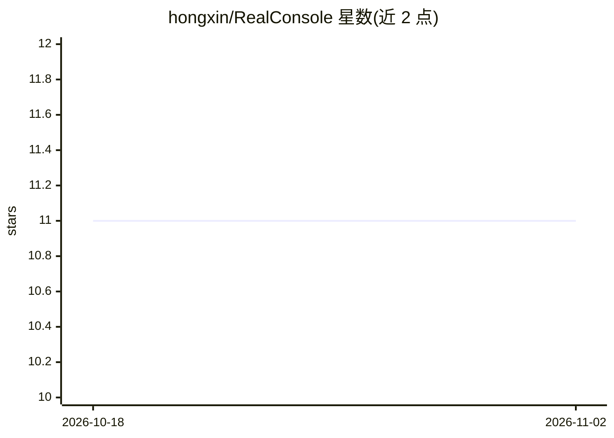

# hongxin/RealConsole

⭐ 11 · Rust · MIT · 推送 2026-01-31 · [GitHub](https://github.com/hongxin/RealConsole) · 个人维护 · 中文 README

**Rust 编写的智能命令行 Agent，含 Web 终端**

用 Rust 构建的命令行智能体，提供 LLM 对话、命令智能路由、主动建议、任务编排（/plan）与 DevOps 工具（Git 助手、日志分析、系统监控）。支持 Ollama 本地及 Deepseek/Gemini/OpenAI 等 LLM 提供商，具备工具调用与意图分解。另提供基于 Axum+WebSocket 的 Web 终端模式，支持 LAN/移动端访问。通过 git clone + make install 或 cargo build 从源码构建，需 Rust 1.70+。作者声明仅供教育/研究/技术探索，不建议用于生产环境。

## 筛选速览

| 维度 | 判定 | 备注 |
|---|---|---|
| AI 角色 | `ai-native` | 本体是模型或模型工具 |
| 许可风险 | `permissive` | MIT |
| 部署形态 | `None` |  |
| 模型依赖 | local-ok | 支持本地模型 |
| 硬件要求 | — | 无带数字的原话,不猜 |
| 安装摩擦 | `medium` | 含编译或系统依赖之一 |
| 成熟度 | `idea` | |

## 能力要点

- LLM 集成支持 Ollama（本地）/Deepseek/Gemini/OpenAI
- 自然语言目标分解为任务并依赖分析并行执行
- Web 终端模式（Axum+WebSocket，支持 LAN 与移动端）
- 命令智能路由（100+ 命令自动识别）与 14+ 内置工具

## 适用场景

- 在终端中通过自然语言对话执行命令和管理任务
- 通过 Web 终端在移动设备或局域网内远程操作
- 用 AI 生成 Git 提交信息、分析日志与系统状态

## 场景标签

`AI 助手` `工作流自动化` · 领域:效率与自动化

## 证据(README 行号)

> L14: **RealConsole** is an intelligent command-line agent built with Rust, based on the "One Divides into Three" (一分为三) 
> L121: - **LLM Integration**: Ollama (local) / Deepseek / Gemini / OpenAI support
> L140: - **Natural Language Goals**: Describe what you want, AI decomposes into tasks

## 星数曲线

2026-10-18 11 → 2026-11-02 11（+0）

---
*卡片 v1 · prompt 1.4 · 生成 2026-11-02 · 置信度 high · 依据 README sha `28da69fc1981` · [字段定义](../../DATASET.md)*
