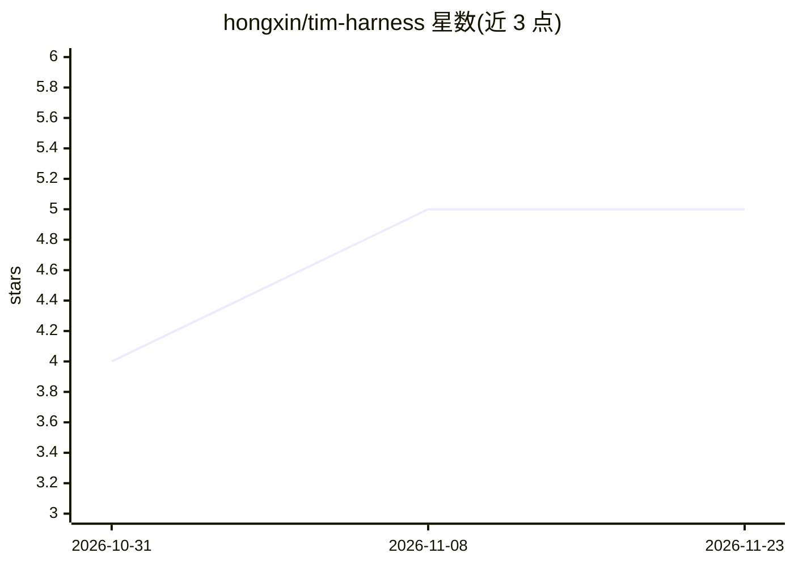

# hongxin/tim-harness

⭐ 5 · TypeScript · MIT · 推送 2026-10-27 · [GitHub](https://github.com/hongxin/tim-harness) · [官网](https://hongxin.github.io/tim-harness/) · 个人维护 · 中文 README

**装进单个网页的浏览器端 LLM 编程助手**

零后端的浏览器内 AI 编程 Harness：内置 18-19 个工具（文件读写/编辑/搜索、JS 沙箱、网页抓取、子代理派发、任务规划、技能系统等），用户填一次 OpenAI 兼容 API Key 即可使用。数据经 OPFS/IndexedDB 在浏览器本地持久化，密钥不出浏览器；通过五层成本机制（工具输出瘦身、前缀缓存、视图折叠、增量压缩、成本档位）降低输入费用；提供四种执行过程可视化视图。npm 安装或在线演示直接打开使用，core 可移植到微信小程序。

## 筛选速览

| 维度 | 判定 | 备注 |
|---|---|---|
| AI 角色 | `ai-native` | 本体是模型或模型工具 |
| 许可风险 | `permissive` | MIT |
| 部署形态 | `library` | 以包/库形式分发 |
| 模型依赖 | local-ok | 支持本地模型 |
| 硬件要求 | — | 无带数字的原话,不猜 |
| 安装摩擦 | `low` | 无编译、无系统依赖或容器化 |
| 成熟度 | — | 结构信号不足 |

## 能力要点

- 18 个工具的完整智能体工具链，多轮工具调用与子代理派发
- 五层 Token 经济机制，前缀缓存下实测省 84-90% 输入费用
- OPFS 持久化 + IndexedDB 会话 + Web Worker 沙箱，密钥仅存本地浏览器
- 四种可视化视图：对话 / 3D 星图 / 装配线 / 战场模式

## 适用场景

- 不搭后端、在浏览器里直接运行一个 AI 编程助手
- 用 DeepSeek 等兼容 API 降低智能体调用的 token 成本
- 完全离线场景下连接本地 Ollama 使用编程助手
- 可视化观察智能体的多轮工具执行过程

## 场景标签

`编码 Agent` · 领域:编码与开发

## 证据(README 行号)

> L13: 打开页面 → 填一次 API Key → 你就拥有一个完整的 AI 编程助手：
> L14: 多轮工具调用、虚拟文件系统、代码沙箱、子代理派发——全部在你的浏览器里，零后端，零安装。
> L38: **⚡ 零安装零后端** — 打开网页即用。OPFS 持久化工作区、IndexedDB 会话存储、Web Worker 代码沙箱，密钥永不出浏览器。

## 星数曲线

2026-10-31 4 → 2026-11-23 5（+1）

---
*卡片 v1 · prompt 1.4 · 生成 2026-11-21 · 置信度 high · 依据 README sha `7d36ba560377` · [字段定义](../../DATASET.md)*
