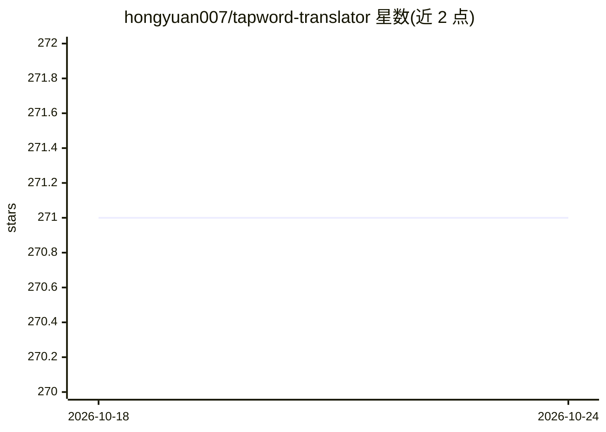

# hongyuan007/tapword-translator

⭐ 272 · TypeScript · AGPL-3.0 · 推送 2026-07-26 · [GitHub](https://github.com/hongyuan007/tapword-translator) · [官网](http://www.tapword.cn) · 个人维护 · 中文 README

**在原文下方显示字幕式 AI 翻译的 Chrome 扩展**

面向语言学习者与外语阅读者的浏览器划词翻译扩展：选中文本后，LLM 驱动的上下文翻译以字幕形式直接显示在原文下方，无弹窗中断；支持部分选词自动扩展为完整单词。社区版开源（AGPL-3.0），采用自带 API Key 模式，可配置 OpenAI、DeepSeek 或任意 OpenAI 兼容接口；也可从 Chrome Web Store 安装官方免费版。技术栈为 TypeScript + Vite，通过编译时环境变量区分社区版与私有官方版构建。

## 筛选速览

| 维度 | 判定 | 备注 |
|---|---|---|
| AI 角色 | `ai-native` | 本体是模型或模型工具 |
| 许可风险 | `viral` | AGPL-3.0 |
| 部署形态 | `library` | 以包/库形式分发 |
| 模型依赖 | locked-api |  |
| 硬件要求 | — | 无带数字的原话,不猜 |
| 安装摩擦 | `low` | 无编译、无系统依赖或容器化 |
| 成熟度 | — | 结构信号不足 |

## 能力要点

- 翻译以字幕形式内联显示在原文下方，无弹窗
- LLM 驱动的整句上下文翻译
- 部分选词自动扩展为完整单词
- 社区版支持自定义 OpenAI 兼容 API（OpenAI/DeepSeek 等）

## 适用场景

- 阅读外语网页时获得不打断阅读流的对照翻译
- 语言学习者做双语沉浸式阅读与划词查词
- 自带 API Key 隐私优先地使用 LLM 翻译

## 场景标签

 · 领域:翻译/浏览器工具

## 证据(README 行号)

> L29: Placing context-aware translations **directly below the original text**, just like subtitles in a movie or annotati
> L41: Powered by advanced AI (LLMs), it understands the **full context** of sentences, delivering translations that are f

## 星数曲线

2026-10-18 271 → 2026-10-24 271（+0）

---
*卡片 v1 · prompt 1.4 · 生成 2026-10-22 · 置信度 mid · 依据 README sha `4a450cb85b70` · [字段定义](../../DATASET.md)*
