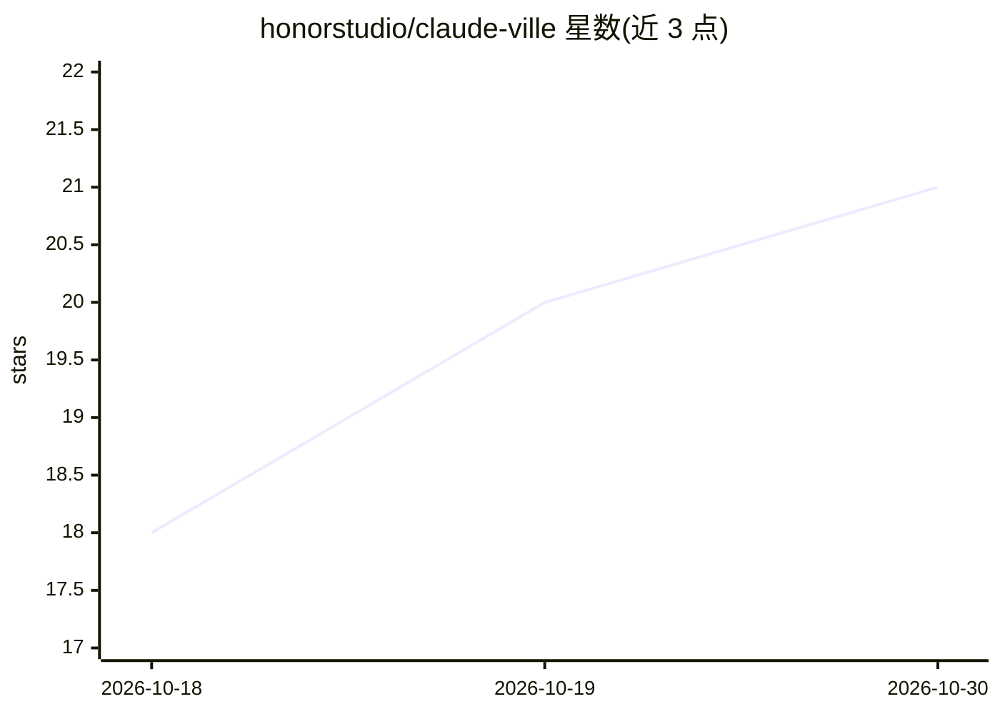

# honorstudio/claude-ville

⭐ 21 · JavaScript · 推送 2026-09-28 · [GitHub](https://github.com/honorstudio/claude-ville) · 个人维护

**AI 编码 agent 会话的实时可视化监控面板**

面向使用 Claude Code、Codex CLI、Gemini CLI 的开发者的通用仪表盘：读取各 CLI 本地存储的会话日志目录（~/.claude/、~/.codex/、~/.gemini/），通过适配器模式归一化为统一格式，经 WebSocket 流式推送到浏览器。提供等距像素村庄世界模式与实时监控卡片模式，自动检测 agent 团队/群体/子代理，按项目分组展示，另含显示 agent 状态与 token 用量的 macOS 菜单栏小部件。纯 Node.js 实现、零 npm 依赖，仅需 Node.js v18+ 与至少一个受支持 CLI。

## 筛选速览

| 维度 | 判定 | 备注 |
|---|---|---|
| AI 角色 | `ai-ecosystem` | LLM/agent 周边工具 |
| 许可风险 | `permissive` | — |
| 部署形态 | `library` | 以包/库形式分发 |
| 模型依赖 | locked-api |  |
| 硬件要求 | — | 无带数字的原话,不猜 |
| 安装摩擦 | `low` | 无编译、无系统依赖或容器化 |
| 成熟度 | — | 结构信号不足 |

## 能力要点

- 统一读取 Claude Code / Codex CLI / Gemini CLI 三家本地会话日志
- 等距像素村庄模式与实时监控卡片双视图
- WebSocket + 文件监听实现即时会话更新
- 零 npm 依赖，纯 Node.js 内置模块实现

## 适用场景

- 在同一面板中监视多个 AI 编码 CLI 工具的会话活动
- 观察 Claude Code 团队/群体/子代理的协作状态
- 在 macOS 菜单栏快速查看 agent 工作状态与 token 用量

## 场景标签

`LLM 可观测性` · 领域:评测与运维

## 证据(README 行号)

> L27: ClaudeVille is a **universal dashboard** for AI coding agents. It visualizes sessions from **Claude Code**, **OpenA
> L29: Each CLI stores session logs locally. ClaudeVille reads them all, merges them into a single unified view, and strea

## 星数曲线

2026-10-18 18 → 2026-10-30 21（+3）

---
*卡片 v1 · prompt 1.4 · 生成 2026-10-28 · 置信度 mid · 依据 README sha `0d4d0a92c9c6` · [字段定义](../../DATASET.md)*
