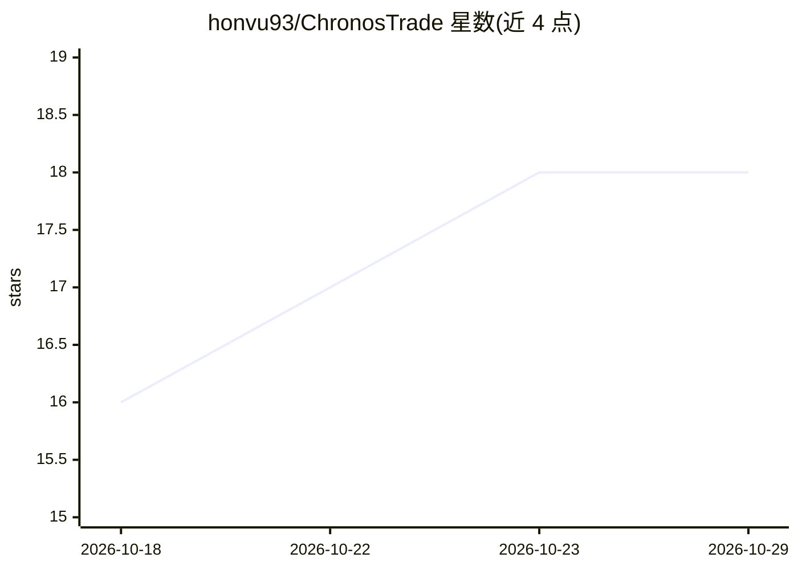

# honvu93/ChronosTrade

⭐ 18 · TypeScript · ISC · 推送 2026-06-09 · [GitHub](https://github.com/honvu93/ChronosTrade) · 个人维护 · 中文 README

**量化交易回测与实盘执行平台：数据、回测、MT5 自动下单**

基于 Node.js/TypeScript 的量化交易与分析平台，提供行情数据接入、技术指标动态参数计算、基于 BullMQ 并行 worker 的高并发回测与网格参数寻优、实时信号分发，以及经 Python 桥接服务对接 MetaTrader 5 终端的自动下单。面向量化开发者与算法交易者，前端为 Next.js 仪表盘（TradingView Lightweight Charts）。附带离场策略与风险护栏（连亏冷却、日亏损上限、权益曲线过滤）。README 未描述 AI/机器学习模型组件，仓库主题标签含 ai-agent/ai-coding。自托管部署需 Node 20+、Docker、Python 3.8+ 与本地 MT5 终端。

## 筛选速览

| 维度 | 判定 | 备注 |
|---|---|---|
| AI 角色 | `ai-enhanced` | 去掉 AI 部分产品仍成立 |
| 许可风险 | `permissive` | ISC |
| 部署形态 | `self-host` | docker 或自建部署 |
| 模型依赖 | — | README 未给出锁定关系 |
| 硬件要求 | — | 无带数字的原话,不猜 |
| 安装摩擦 | `low` | 无编译、无系统依赖或容器化 |
| 成熟度 | — | 结构信号不足 |

## 能力要点

- BullMQ worker 池并行回测与网格参数寻优
- Python 桥接服务对接 MetaTrader 5 历史数据与实盘下单
- 指标参数经 FieldSchema 声明，前端动态生成表单
- 离场策略与 Trade Guards 风险护栏（连亏冷却、日/时段亏损上限、权益曲线过滤）
- 预打包 160 万行 XAUUSD/BTCUSD/XAGUSD 历史K线数据

## 适用场景

- 我需要对策略做多参数组合的并行回测与寻优
- 我想在本地把信号经 MT5 终端自动执行下单
- 我想在图表上逐根K线检查指标值与决策日志进行策略调试

## 场景标签

`金融量化` · 领域:学习与行业

## 证据(README 行号)

> L12: **ChronosTrade** is an enterprise-grade quantitative trading and analytics platform. Engineered for high performanc
> L67: ## ⚖️ Why ChronosTrade? (Comparison with Alternatives)

## 星数曲线

2026-10-18 16 → 2026-10-29 18（+2）

---
*卡片 v1 · prompt 1.4 · 生成 2026-10-29 · 置信度 low · 依据 README sha `b4bd362e5aa2` · [字段定义](../../DATASET.md)*
