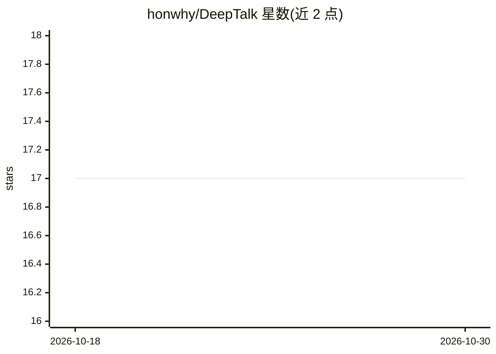

# honwhy/DeepTalk

⭐ 17 · TypeScript · 推送 2026-08-16 · [GitHub](https://github.com/honwhy/DeepTalk) · 个人维护 · 中文 README

**Markdown 转公众号文章的工具：排版渲染、草稿发布与 AI 生成**

面向微信公众号作者的 TypeScript 工具集：Markdown 编辑与转 HTML（16 种主题、内联 CSS 兼容公众号格式）、通过公众号 API 一键发布到草稿箱（含封面上传）、按 URL 抓取公众号文章转为 Markdown，并可用 OpenAI/DeepSeek 生成技术/AI/投资领域文章。提供 5 个 Skills 供 qoder CLI、claude、codex 等 AI CLI 工具协作调用，包括去除 AI 写作痕迹的 humanizer-zh 与 Cloudinary 图床技能。npm 安装，CLI 与 Web 界面两种使用方式。

## 筛选速览

| 维度 | 判定 | 备注 |
|---|---|---|
| AI 角色 | `ai-enhanced` | 去掉 AI 部分产品仍成立 |
| 许可风险 | `none` | — |
| 部署形态 | `library` | 以包/库形式分发 |
| 模型依赖 | locked-api |  |
| 硬件要求 | — | 无带数字的原话,不猜 |
| 安装摩擦 | `low` | 无编译、无系统依赖或容器化 |
| 成熟度 | — | 结构信号不足 |

## 能力要点

- Markdown 转公众号兼容 HTML，16 种主题
- 公众号 API 发布到草稿箱，支持封面图多模式
- 通过 OpenAI/DeepSeek 生成三大领域文章
- 提供 5 个 Skills 与 AI CLI 工具协作

## 适用场景

- 把 Markdown 文章排版成公众号格式并一键发布草稿箱
- 抓取已有公众号文章转为 Markdown 再编辑
- 让 AI 生成主题文章后直接排版发布

## 场景标签

`AI 写作` · 领域:内容生成

## 证据(README 行号)

> L5:  Markdown 转 HTML 工具 + 微信公众号文章生成与发布系统
> L39: ### 6. 大模型文章生成

## 星数曲线

2026-10-18 17 → 2026-10-30 17（+0）

---
*卡片 v1 · prompt 1.4 · 生成 2026-10-29 · 置信度 high · 依据 README sha `bea5d79926e9` · [字段定义](../../DATASET.md)*
