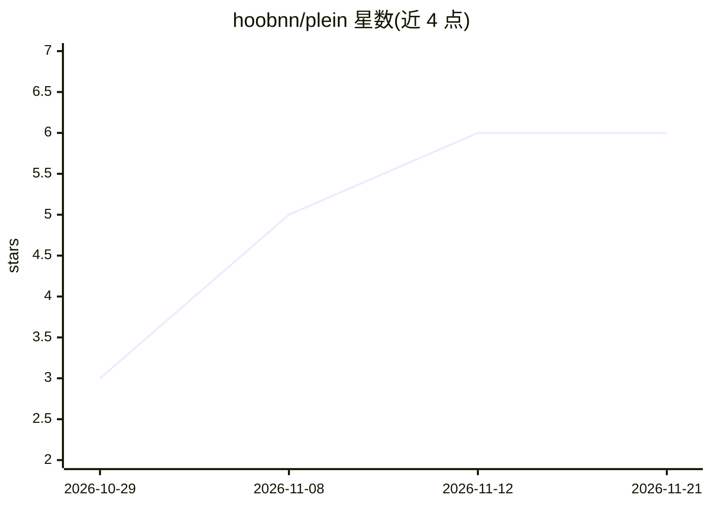

# hoobnn/plein

⭐ 6 · TypeScript · AGPL-3.0 · 推送 2026-11-16 · [GitHub](https://github.com/hoobnn/plein) · [官网](https://plein.ikuyu.com) · 个人维护 · 中文 README

**开源 AI 无限画布短剧创作工具：从创意到成片全流程节点化**

Plein 是 AGPL-3.0 开源的 AI 短剧创作工具：剧本、角色、分镜、镜头图、视频、配音到剪辑序列都是无限画布上连线的节点（PixiJS 渲染、Yjs 文档模型），每步可单独重做，改动后通过「查看影响」只重跑受影响节点，未改动的节点命中缓存避免重复计费。内置智能体「小满」可操作画布，也可经 MCP 接入 Claude Code、Cursor 等外部 AI。数据以 SQLite 与素材目录存于本机，密钥不入浏览器。提供 macOS Apple 芯片桌面版，并可 Docker 自部署；模型生成由用户自己的火山方舟、豆包语音、阿里云百炼、MiniMax 账号计费。

## 筛选速览

| 维度 | 判定 | 备注 |
|---|---|---|
| AI 角色 | `ai-native` | 本体是模型或模型工具 |
| 许可风险 | `viral` | AGPL-3.0 |
| 部署形态 | `desktop` | 安装包/桌面程序 |
| 模型依赖 | — | README 未给出锁定关系 |
| 硬件要求 | — | 无带数字的原话,不猜 |
| 安装摩擦 | `low` | 无编译、无系统依赖或容器化 |
| 成熟度 | `idea` | |

## 能力要点

- 无限画布节点化全流程：剧本→分镜→镜头→序列，每步可单独返工
- 内置智能体「小满」及 MCP 开放，Claude Code/Cursor 可直接操作画布
- 数据本机化：单 Node 进程 + SQLite + 素材目录，密钥仅存本机服务端
- 接入火山方舟、豆包语音、阿里云百炼、MiniMax 四个国内模型平台

## 适用场景

- 用 AI 生成剧本、分镜、镜头图和配音，制作 AI 短剧
- 在画布上管理多镜头项目，只重跑改动的节点以控制生成成本
- 让 Claude Code/Cursor 通过 MCP 批量操作画布节点
- 本机部署、数据与密钥不出本机的创作环境

## 场景标签

`视频生成` `图像生成` · 领域:内容生成

## 证据(README 行号)

> L17: Plein 是一款开源（AGPL-3.0）的 AI 短剧创作工具：创意、剧本、角色、分镜、镜头图、视频、配音到成片都是一张无限画布上连好线的节点，每一步可看可改、可单独重做。提供 macOS（Apple 芯片）桌面版，也可以用 D
> L33: - **由 AI 代为操作**：内置智能体「小满」可以读取画布、创建节点、批量生成分镜、加工素材；也可以交给本机已登录的 Claude Code / Codex，或通过 MCP 让 Cursor、Claude Desktop 直接
> L45: - 文本生成、图片、视频、配音、配乐节点；参数表单按所选模型生成，9 种画幅

## 星数曲线

2026-10-29 3 → 2026-11-21 6（+3）

---
*卡片 v1 · prompt 1.4 · 生成 2026-11-20 · 置信度 mid · 依据 README sha `522ac8fb750f` · [字段定义](../../DATASET.md)*
