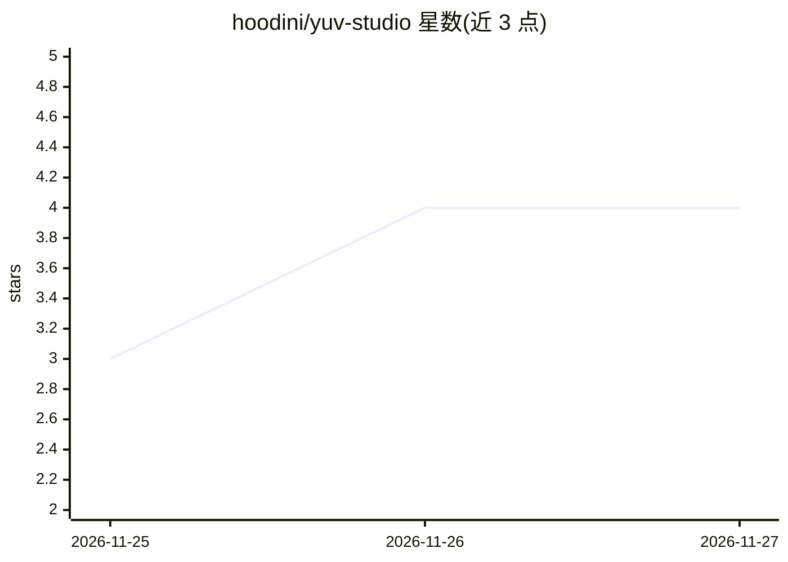

# hoodini/yuv-studio

⭐ 4 · TypeScript · AGPL-3.0 · 推送 2026-11-23 · [GitHub](https://github.com/hoodini/yuv-studio) · [官网](https://yuv.ai) · 个人维护

**给视频创作者与 AI Agent 的浏览器端视频编辑器**

本地运行的浏览器视频编辑器，把每个编辑操作同时暴露为编辑器界面、REST API 和 63 个 MCP 工具，使 Claude、Codex、Cursor 等 Agent 能实时驱动剪辑、字幕、配音与导出，剪辑结果在时间线上可见且可逐步撤销。支持希伯来语和英语字幕（本地 faster-whisper 或云端转录）、竖屏人脸跟随重构图、GPU 背景移除、AI 选取 Shorts 片段、品牌套件与模板，导出 MP4。需 Node.js 22+、ffmpeg/ffprobe 与 Chrome/Edge。

## 筛选速览

| 维度 | 判定 | 备注 |
|---|---|---|
| AI 角色 | `ai-enhanced` | 去掉 AI 部分产品仍成立 |
| 许可风险 | `dual` | AGPL-3.0 |
| 部署形态 | `library` | 以包/库形式分发 |
| 模型依赖 | local-ok | 支持本地模型 |
| 硬件要求 | — | 无带数字的原话,不猜 |
| 安装摩擦 | `medium` | 含编译或系统依赖之一 |
| 成熟度 | — | 结构信号不足 |

## 能力要点

- 编辑器、REST API 与 63 个 MCP 工具共享同一套操作，Agent 可实时驱动剪辑
- 希伯来语与英语字幕：本地 faster-whisper 转录、逐词高亮、9 种样式
- 竖屏重构图跟随人脸、GPU 背景移除、AI Shorts 片段选取
- 编辑器内置 AI 聊天，支持 Claude/OpenAI/Grok/Groq 等或本地 Ollama/LM Studio

## 适用场景

- 让 Claude Code 等 Agent 按指令自动剪辑、加字幕并导出短视频
- 为 Reels/TikTok/Shorts 批量从长视频选取片段并转竖屏
- 本地处理希伯来语/英语视频字幕与配音，素材不出本机

## 场景标签

`编码 Agent` `语音合成` `语音识别` · 领域:编码与开发

## 证据(README 行号)

> L25: YUV.AI Studio makes **every edit an API call**. The same operations sit behind the editor, a REST API and 63 MCP to
> L87: |🔌 **MCP + REST**|63 MCP tools and a REST API over the same operations. Claude Code, Claude Desktop, Codex, Cursor,

## 星数曲线

2026-11-25 3 → 2026-11-27 4（+1）

---
*卡片 v1 · prompt 1.4 · 生成 2026-11-24 · 置信度 mid · 依据 README sha `e9c7999497d2` · [字段定义](../../DATASET.md)*
