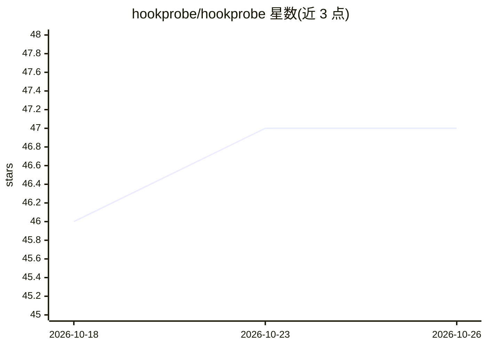

# hookprobe/hookprobe

⭐ 47 · Python · NOASSERTION · 推送 2026-10-12 · [GitHub](https://github.com/hookprobe/hookprobe) · [官网](https://hookprobe.com) · 组织维护

**运行在廉价硬件上的去中心化 AI 入侵检测/防御网格**

HookProbe 是一套开源（AGPL）的网络安全防护系统，面向家庭用户、中小企业与 MSP 服务商。核心组件包括：NAPSE（AI 原生 IDS/NSM/IPS，L2-L7 深度包分析）、Qsecbit 透明威胁评分（公式公开，输出 GREEN/AMBER/RED）、dnsXai 可解释 DNS 拦截、XDP/eBPF 内核级 DDoS 缓解，以及 8 个 AI agent 组成的 AEGIS 自动防御编排器。其机制特色是去中心化安全网格：任一节点检测到威胁后，经拜占庭容错共识（2/3 quorum）以匿名化签名形式同步至全网节点，约 30 秒内完成全网防护；数据不出本地边缘。通过 install.sh 一键安装到 Raspberry Pi 等廉价硬件。

## 筛选速览

| 维度 | 判定 | 备注 |
|---|---|---|
| AI 角色 | `ai-native` | 本体是模型或模型工具 |
| 许可风险 | `none` | NOASSERTION |
| 部署形态 | `None` |  |
| 模型依赖 | — | README 未给出锁定关系 |
| 硬件要求 | — | 无带数字的原话,不猜 |
| 安装摩擦 | `low` | 无编译、无系统依赖或容器化 |
| 成熟度 | — | 结构信号不足 |

## 能力要点

- NAPSE AI 原生 IDS/IPS，覆盖 L2-L7 深度包分析
- 去中心化安全网格：单节点检测经共识后全网约 30 秒内获得防护
- Qsecbit 评分公式公开，威胁判定可解释可审计
- XDP/eBPF 内核级规则可查看与逐条解释
- 联邦学习共享模型权重更新，原始流量数据不上传

## 适用场景

- 在 Raspberry Pi 上搭建家庭网络的入侵检测与拦截
- 中小企业以低成本硬件获得入侵防护与可审计日志
- MSP 通过多租户平台向客户提供托管安全服务
- 查看实时威胁评分与全球攻击态势可视化

## 场景标签

`网络安全` · 领域:学习与行业

## 证据(README 行号)

> L165: |**NAPSE**|Neural Adaptive Packet Synthesis Engine|AI-native IDS/NSM/IPS with L2-L7 deep packet analysis|
> L184: 1. DETECTION   → NAPSE identifies threat (AI-native, L2-L7)

## 星数曲线

2026-10-18 46 → 2026-10-26 47（+1）

---
*卡片 v1 · prompt 1.4 · 生成 2026-10-25 · 置信度 high · 依据 README sha `f556e0360690` · [字段定义](../../DATASET.md)*
