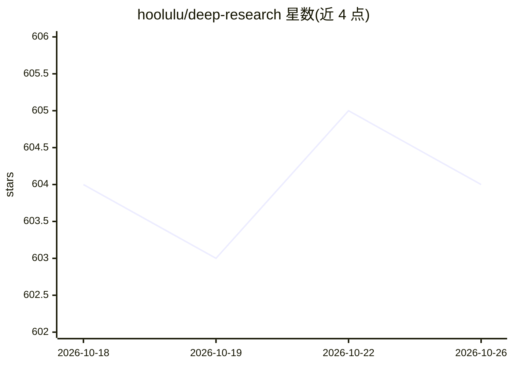

# hoolulu/deep-research

⭐ 604 · Python · MIT · 推送 2026-08-30 · [GitHub](https://github.com/hoolulu/deep-research) · [官网](https://www.h33.top) · 个人维护 · 中文 README

**面向 AI 编程工具的深度调研报告生成 Skill，一条命令产出报告**

可装入 Claude Code、Codex CLI、Cursor、OpenCode 等 AI 工具的 skill：输入 /research <主题>，经分析大纲→四层并行搜索→Scrapling 批量抓取→并行写作→校验组装的四阶段流水线，约 10-20 分钟生成带 (N) 可点击引用、置信度分级与对立观点的 Markdown 报告，支持 19 种语言自动检测与中文源（百度/知乎/199IT 等）。面向独立开发者、独立研究者与小团队，提供 quick/standard/deep 三档深度，另有离线本地文件模式与本地报告浏览器页面，PDF/DOCX 纯客户端导出。运行前提是宿主 AI 工具与 Scrapling（离线模式不需要）。

## 筛选速览

| 维度 | 判定 | 备注 |
|---|---|---|
| AI 角色 | `ai-native` | 本体是模型或模型工具 |
| 许可风险 | `permissive` | MIT |
| 部署形态 | `None` |  |
| 模型依赖 | — | README 未给出锁定关系 |
| 硬件要求 | — | 无带数字的原话,不猜 |
| 安装摩擦 | `low` | 无编译、无系统依赖或容器化 |
| 成熟度 | — | 结构信号不足 |

## 能力要点

- 四阶段自动化流水线：大纲→搜索抓取→并行写作→校验组装，全程无人工干预
- 19 种语言自动检测并在同一语言原生写作，非翻译管线
- 四层优先级并行搜索：内置引擎→大纲建议源→sources.json（30+ 源、启动时健康检查）→免费源兜底
- 每章含争议与对立观点，末尾输出高/中/低置信度分级表，本地报告浏览器支持搜索筛选与客户端 PDF/DOCX 导出

## 适用场景

- 让 AI 编程工具一条命令生成可引用的中文行业/政策/技术深度调研报告
- 无需付费数据库，个人完成券商式结构（结论先行、来源可溯、情景预测）的调研
- 用本地 PDF/DOCX/TXT/MD 材料离线生成报告
- 多语言团队按主题语言直接产出对应语种报告

## 场景标签

`科研工具` `AI 写作` · 领域:内容生成

## 证据(README 行号)

> L7: Multi-agent autonomous search, scrape, write, and QA — feed it a topic, get a citable, browsable, exportable researc
> L20:  🎯 One command <code>/research &lt;topic&gt;</code> → fully automated research, zero manual intervention

## 星数曲线

2026-10-18 604 → 2026-10-26 604（+0）

---
*卡片 v1 · prompt 1.4 · 生成 2026-10-21 · 置信度 high · 依据 README sha `1ea628d90e11` · [字段定义](../../DATASET.md)*
