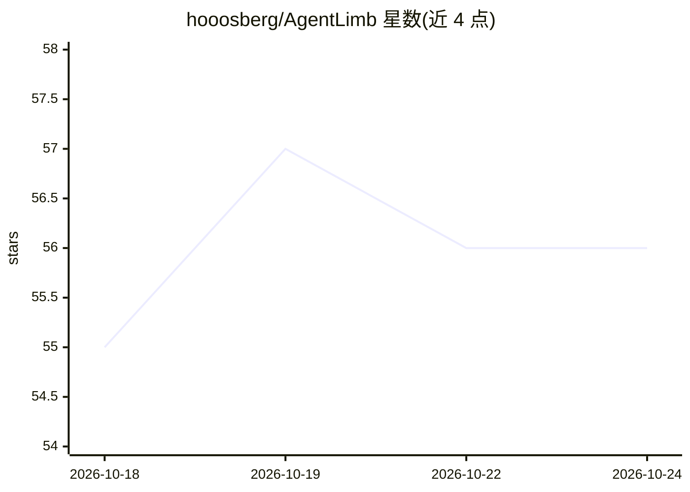

# hooosberg/AgentLimb

⭐ 56 · JavaScript · NOASSERTION · 推送 2026-10-23 · [GitHub](https://github.com/hooosberg/AgentLimb) · [官网](https://hooosberg.com/apps/agentlimb/) · 个人维护 · 中文 README

**让任意 MCP AI agent 操控本机 Chrome 的浏览器控制扩展**

Chrome 扩展加本地 MCP host 的组合：MCP 客户端经 stdio 连接本地 host，host 通过 SSE/POST 与扩展通信，扩展以 CDP debugger 与常驻 a11y 脚本执行 17 个工具（标签页管理、读页、表单填写、javascript_eval、browser_batch 批量动作等）。配对方式为复制一段提示词打开 30 分钟接入窗口，首个连接的 AI 被自动信任，无确认页与配对码。附带按站点 Markdown 记录的 site_memory、多 Chrome 配置路由与每个 AI 隔离的侧边栏聊天窗口。零 npm 依赖，100% 本地运行。

## 筛选速览

| 维度 | 判定 | 备注 |
|---|---|---|
| AI 角色 | `ai-ecosystem` | LLM/agent 周边工具 |
| 许可风险 | `none` | NOASSERTION |
| 部署形态 | `None` |  |
| 模型依赖 | — | README 未给出锁定关系 |
| 硬件要求 | — | 无带数字的原话,不猜 |
| 安装摩擦 | `low` | 无编译、无系统依赖或容器化 |
| 成熟度 | — | 结构信号不足 |

## 能力要点

- 17 个浏览器工具（含 browser_batch 单次最多 20 个动作、site_memory 站点记忆）
- 复制提示词即完成首次授权：30 分钟窗口、无确认页、无配对码
- 常驻 CDP attach + SSE 推送 + 后台标签可操作
- 每客户端隔离信任与聊天窗口，最多同时连接 6 个 MCP host

## 适用场景

- 让 Claude Code、Cursor 等 MCP 客户端直接操作我的 Chrome 完成网页任务
- 多账号多 Chrome 配置下由 AI 并行/顺序操作不同浏览器
- 通过侧边栏与当前控制的 AI 对话查看其正在操作的页面

## 场景标签

`浏览器自动化` · 领域:效率与自动化

## 证据(README 行号)

> L12: A universal browser-control extension: it gives any MCP-capable agent hands, so it can drive your Chrome.
> L53: ┌─────────────┐  stdio MCP   ┌──────────────────────┐  SSE (push)  ┌─────────────────────┐
> L68: |Local host|`host/` `bin/`|MCP stdio server + local HTTP/SSE bridge|

## 星数曲线

2026-10-18 55 → 2026-10-24 56（+1）

---
*卡片 v1 · prompt 1.4 · 生成 2026-10-24 · 置信度 high · 依据 README sha `5cbfd9e3aade` · [字段定义](../../DATASET.md)*
