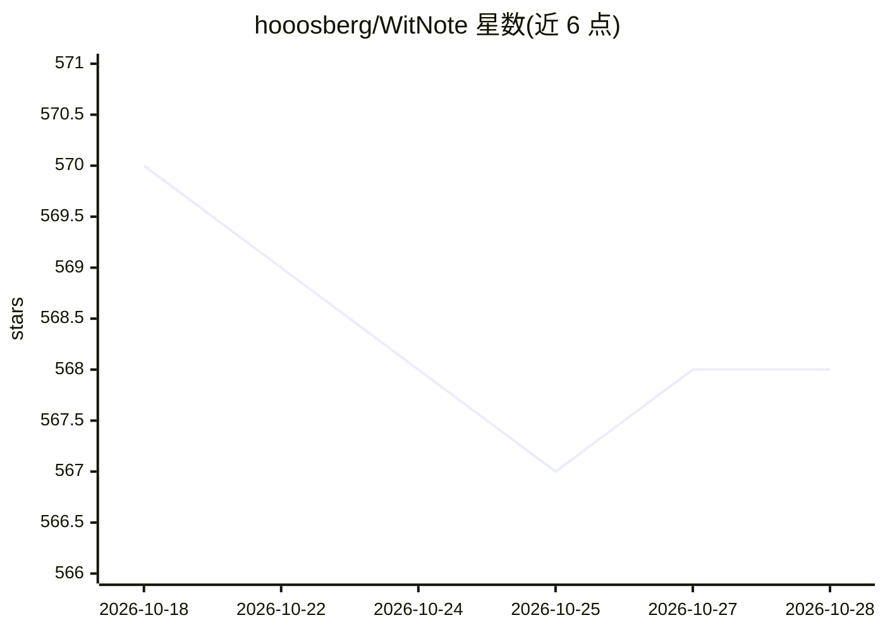

# hooosberg/WitNote

⭐ 568 · TypeScript · 推送 2026-10-13 · [GitHub](https://github.com/hooosberg/WitNote) · [官网](https://hooosberg.com/apps/witnote/) · 个人维护 · 中文 README

**本地优先的 Markdown 双栏编辑器，带离线/云端 AI 写作辅助**

Electron 构建的开源跨平台 Markdown 笔记编辑器，主打双栏编辑（左写右实时渲染，支持 GFM 与 LaTeX）、文件库式工作区（无数据库、无专有格式锁定）与 100% 本地存储。AI 作为辅助功能存在：可连接本地 Ollama 或云端 API（DeepSeek、OpenAI 等），充当离线百科、翻译与写作助手，支持一键清除上下文。macOS/iOS 端已转向 Swift/SwiftUI 原生架构并上架 Mac App Store；开源版面向 Windows/Linux 提供 x86_64 与 ARM64 安装包及 AppImage/deb，也可从源码构建。

## 筛选速览

| 维度 | 判定 | 备注 |
|---|---|---|
| AI 角色 | `ai-enhanced` | 去掉 AI 部分产品仍成立 |
| 许可风险 | `none` | — |
| 部署形态 | `desktop` | 安装包/桌面程序 |
| 模型依赖 | local-ok | 支持本地模型 |
| 硬件要求 | — | 无带数字的原话,不猜 |
| 安装摩擦 | `low` | 无编译、无系统依赖或容器化 |
| 成熟度 | — | 结构信号不足 |

## 能力要点

- 双栏 Markdown 编辑，实时渲染 GFM 与 LaTeX 数学公式
- AI 辅助：连接 Ollama 本地模型或 DeepSeek/OpenAI 等云端 API
- 文件即存储的 Vault 工作区，100% 本地保存，不上传笔记与密钥
- Windows/Linux 提供 x86_64 与 ARM64 的 exe/AppImage/deb 官方包

## 适用场景

- 需要一个无数据库、纯文件方式的本地 Markdown 笔记本
- 写作时随手调用本地或云端 AI 做翻译与润色
- 在不联网环境下管理并渲染带公式的技术笔记

## 场景标签

`AI 写作` `知识库管理` · 领域:内容生成

## 证据(README 行号)

> L3:  WitNote
> L43: - 🤖 **Lightweight AI Companion**: AI is not a complicated, intrusive agent here—it functions simply as an offline e
> L72: - 🤖 **Clean AI Integration** — Connect effortlessly with **Ollama** (local powerful models) or **Cloud API** (DeepS

## 星数曲线

2026-10-18 570 → 2026-10-28 568（-2）

---
*卡片 v1 · prompt 1.4 · 生成 2026-10-21 · 置信度 high · 依据 README sha `c16873bf4872` · [字段定义](../../DATASET.md)*
