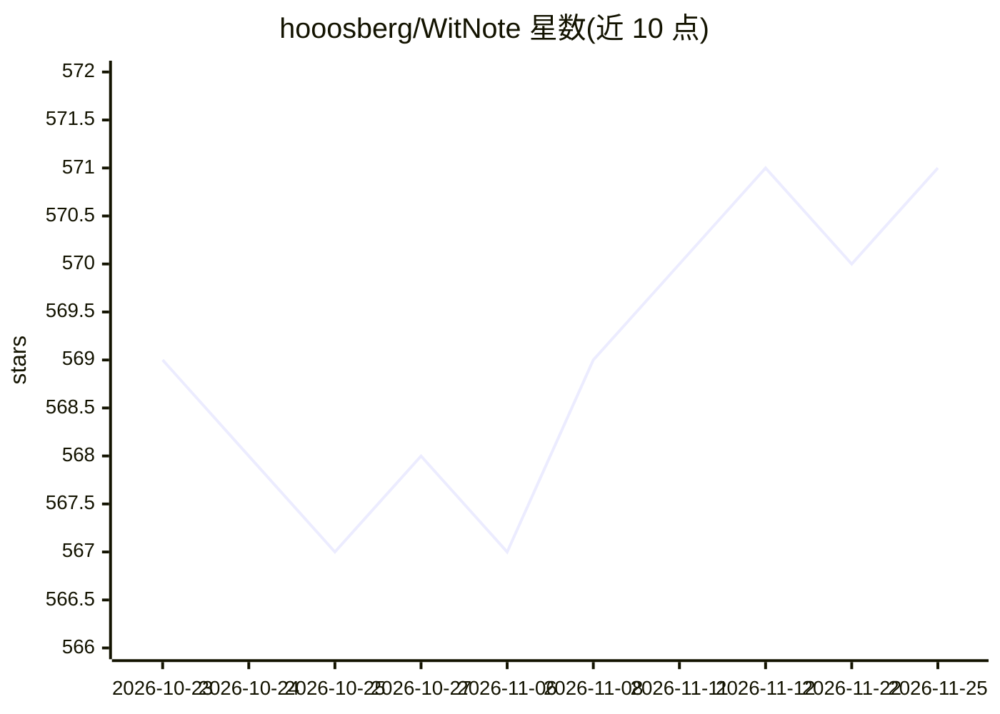

# hooosberg/WitNote

⭐ 571 · TypeScript · 推送 2026-11-15 · [GitHub](https://github.com/hooosberg/WitNote) · [官网](https://hooosberg.com/apps/witnote/) · 个人维护 · 中文 README

**本地优先的 Markdown 双栏编辑器，内置轻量 AI 写作助手**

基于 Electron 的跨平台 Markdown 工作区（开源版覆盖 Windows/Linux/macOS），主打无数据库、纯文件的双栏编辑：左侧书写、右侧实时渲染，支持 GFM、LaTeX 数学公式与代码高亮，文件夹可直接作为 vault 打开。AI 部分定位为轻量伴侣——离线百科、翻译与写作辅助，可连接本地 Ollama 或 DeepSeek/OpenAI 等云 API，带一键清空上下文。Apple 平台另提供 Swift/SwiftUI 原生版上架 App Store，开源版为 MIT 许可，数据 100% 存本地。

## 筛选速览

| 维度 | 判定 | 备注 |
|---|---|---|
| AI 角色 | `ai-enhanced` | 去掉 AI 部分产品仍成立 |
| 许可风险 | `none` | — |
| 部署形态 | `desktop` | 安装包/桌面程序 |
| 模型依赖 | local-ok | 支持本地模型 |
| 硬件要求 | — | 无带数字的原话,不猜 |
| 安装摩擦 | `low` | 无编译、无系统依赖或容器化 |
| 成熟度 | — | 结构信号不足 |

## 能力要点

- 纯双栏 Markdown 编辑，GFM 与 LaTeX 数学渲染
- 文件夹即工作区，无数据库、无专有格式锁定
- 可接 Ollama 本地模型或 DeepSeek/OpenAI 等云 API
- v2.0.1 起官方安装包同时支持 x86_64 与 ARM64

## 适用场景

- 本地管理个人 Markdown 笔记与文档 vault
- 离线环境下借助本地模型进行翻译与写作辅助
- 需要 ARM64（如骁龙/ Surface）设备的原生安装包

## 场景标签

`AI 写作` `知识库管理` · 领域:内容生成

## 证据(README 行号)

> L43: - 🤖 **Lightweight AI Companion**: AI is not a complicated, intrusive agent here—it functions simply as an offline e
> L78: - 🤖 **Clean AI Integration** — Connect effortlessly with **Ollama** (local powerful models) or **Cloud API** (DeepS

## 星数曲线

2026-10-23 569 → 2026-11-25 571（+2）

---
*卡片 v1 · prompt 1.4 · 生成 2026-11-25 · 置信度 high · 依据 README sha `44839f72ee22` · [字段定义](../../DATASET.md)*
