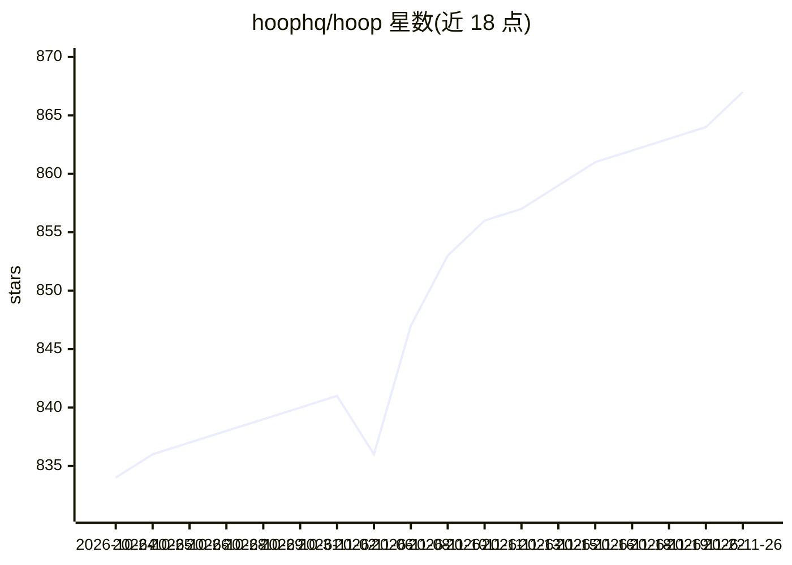

# hoophq/hoop

⭐ 867 · Go · MIT · 推送 2026-11-25 · [GitHub](https://github.com/hoophq/hoop) · [官网](https://hoop.dev) · 组织维护

**AI Agent 运行时边车：脱敏数据并拦截破坏性命令**

以边车形式部署在 Agent 与数据库/资源之间：修改连接串端口即可接入，无需 SDK 或 prompt 改动。四大控制：响应内存中重写敏感字段的数据脱敏、按有序 deny list 拒绝破坏性语句并以 pgwire 错误回传原因、由 Agent 打分动作风险的 Session Analyzer（本地规则先于模型调用）、高风险操作升级人工一次性审批。单二进制单配置文件，支持 PostgreSQL、MSSQL、HTTP 三种协议；附带控制平面统一管理边车集群，仓库中另含仍受支持的人类基础设施访问网关。

## 筛选速览

| 维度 | 判定 | 备注 |
|---|---|---|
| AI 角色 | `ai-ecosystem` | LLM/agent 周边工具 |
| 许可风险 | `permissive` | MIT |
| 部署形态 | `self-host` | docker 或自建部署 |
| 模型依赖 | — | README 未给出锁定关系 |
| 硬件要求 | — | 无带数字的原话,不猜 |
| 安装摩擦 | `low` | 无编译、无系统依赖或容器化 |
| 成熟度 | — | 结构信号不足 |

## 能力要点

- 脱敏在内存中重写响应，请求本身不被改动
- Guardrails deny list 拦截破坏性 SQL 并回传可配置原因
- Session Analyzer 本地规则先行，被拒语句不消耗模型调用
- Agent 无感知接入：仅改连接串端口

## 适用场景

- 让 Agent 访问生产数据库时隐藏敏感字段
- 阻止 Agent 执行 DELETE/DROP 等破坏性语句
- 高风险 Agent 操作走人工审批队列
- 统一管理多台边车的脱敏与拦截规则

## 场景标签

`网络安全` · 领域:学习与行业

## 证据(README 行号)

> L1: Runtime control for agents
> L77: **Session Analyzer.** An agent scores every action's intent and syntax for risk before it executes. Local rules run

## 星数曲线

2026-10-24 834 → 2026-11-26 867（+33）

---
*卡片 v1 · prompt 1.4 · 生成 2026-11-24 · 置信度 mid · 依据 README sha `31fd6bb8380d` · [字段定义](../../DATASET.md)*
