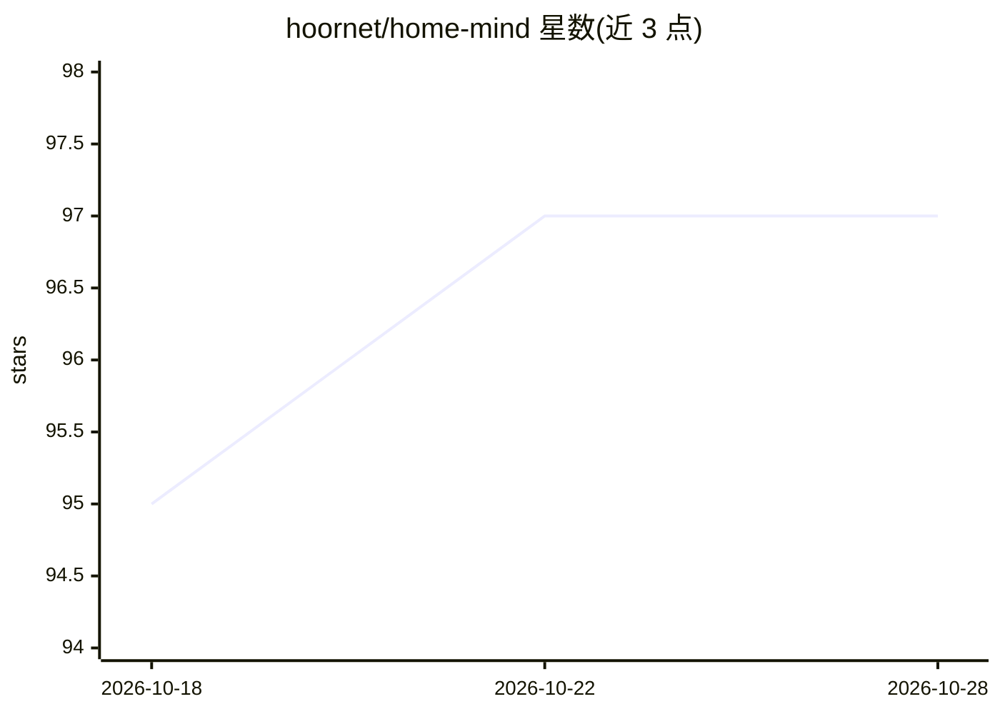

# hoornet/home-mind

⭐ 98 · TypeScript · AGPL-3.0 · 推送 2026-10-23 · [GitHub](https://github.com/hoornet/home-mind) · [官网](https://nives.house) · 个人维护

**给智能家居用户的带认知记忆的 Home Assistant AI 助手**

自托管的 Home Assistant 对话助手：通过 HA Assist（语音或文本）交互，控制设备、查询传感器。核心机制是经 Shodh Memory 实现持久认知记忆（语义搜索、自然衰减），可记住传感器基线与用户纠正，支持按请求遗忘并先确认。读取 HA 楼层/房间分配生成 Home Layout Index，启动时预扫描灯光能力生成注入提示词的速查表。多 LLM 支持（Anthropic/OpenAI/Ollama/OpenAI 兼容端点），以 HA 插件或 Docker Compose 部署，自述处于 early access。

## 筛选速览

| 维度 | 判定 | 备注 |
|---|---|---|
| AI 角色 | `ai-native` | 本体是模型或模型工具 |
| 许可风险 | `viral` | AGPL-3.0 |
| 部署形态 | `desktop` | 安装包/桌面程序 |
| 模型依赖 | local-ok | 支持本地模型 |
| 硬件要求 | — | 无带数字的原话,不猜 |
| 安装摩擦 | `low` | 无编译、无系统依赖或容器化 |
| 成熟度 | `idea` | |

## 能力要点

- 经 Shodh Memory 实现跨会话持久记忆与按请求遗忘（先确认再删）
- Home Layout Index 与 Device Capability Index 注入每次提示词
- 多 LLM 提供商：Anthropic、OpenAI、Ollama 本地推理及 OpenAI 兼容端点
- 两种部署方式：Home Assistant 插件（amd64）或 Docker Compose

## 适用场景

- 用语音或文字向家中的 AI 助手询问传感器读数并控制设备
- 让助手记住我对设备昵称、偏好和纠正，下次会话仍生效
- 在 Home Assistant 上自托管一个注重隐私、支持本地推理的对话助手

## 场景标签

`AI 助手` `语音 Agent` `Agent 记忆` · 领域:Agent 开发

## 证据(README 行号)

> L8: AI assistant for Home Assistant with cognitive memory. Adds learning capabilities, persistent memory, and voice cont
> L28: - **Multi-LLM support.** Anthropic (Claude), OpenAI, Ollama (local inference), or any OpenAI-compatible endpoint su

## 星数曲线

2026-10-18 95 → 2026-10-28 97（+2）

---
*卡片 v1 · prompt 1.4 · 生成 2026-10-23 · 置信度 high · 依据 README sha `5118d557cc23` · [字段定义](../../DATASET.md)*
