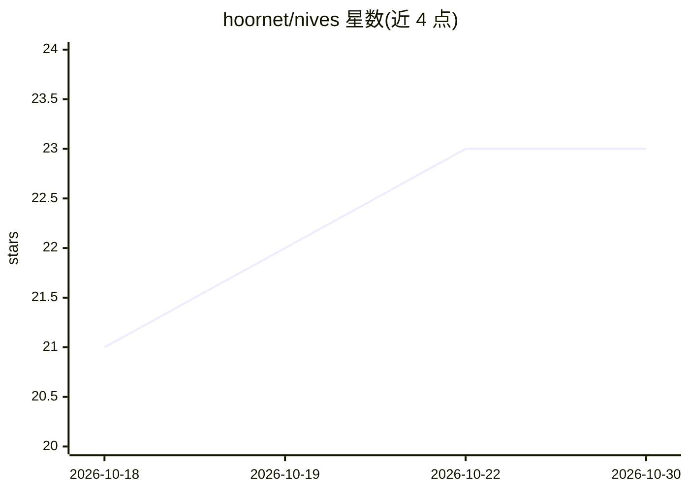

# hoornet/nives

⭐ 23 · TypeScript · AGPL-3.0 · 推送 2026-10-29 · [GitHub](https://github.com/hoornet/nives) · 个人维护

**带持久记忆的 Home Assistant AI 语音/文字助手插件**

以 Home Assistant 插件形式安装的 AI 助手：通过 HA Assist 以语音或文字对话，跨会话记住用户偏好、例程、设备昵称与传感器基线（记忆库存储在本机，基于 Shodh Memory 语义检索）。支持自然语言创建/修改自动化并在执行前强制确认与风险提示，可读取摄像头快照、跨多个传感器历史做归因分析。模型接入两途：托管的 Nives Cloud（当前新注册暂停）或自带 key（Anthropic/OpenAI/OpenRouter/Mistral/本地 Ollama），要求模型支持 function calling，本地运行建议 8k 以上上下文与约 14B 规模模型。

## 筛选速览

| 维度 | 判定 | 备注 |
|---|---|---|
| AI 角色 | `ai-native` | 本体是模型或模型工具 |
| 许可风险 | `viral` | AGPL-3.0 |
| 部署形态 | `self-host` | docker 或自建部署 |
| 模型依赖 | local-ok | 支持本地模型 |
| 硬件要求 | — | 无带数字的原话,不猜 |
| 安装摩擦 | `low` | 无编译、无系统依赖或容器化 |
| 成熟度 | — | 结构信号不足 |

## 能力要点

- 跨会话持久记忆，存储在本机 Home Assistant 机器上，无遥测
- 自然语言创建/编辑自动化，服务器端强制确认并提示条件缺失等风险
- 支持语音与文字，可处理名字误听、多语言回复与麦克风重开
- BYOK 支持 Anthropic/OpenAI/OpenRouter/Mistral/本地 Ollama，亦可作为 HA AI Task 提供方

## 适用场景

- 用一句话让助手建立或修改家庭自动化并在确认后执行
- 询问空气质量等传感器异常原因并获得多传感器归因分析
- 让助手记住家庭偏好与设备昵称，无需重复说明

## 场景标签

`AI 助手` `语音 Agent` · 领域:对话与助手

## 证据(README 行号)

> L7:  Nives (pronounced Nee-wes - traditional Slovenian female name) is an AI assistant for Home Assistant that remembers
> L12: Talk to your home in plain language, by voice or text through HA Assist, and Nives recalls your preferences, routin
> L83: Nives needs a language model to do the thinking. You have two options, picked in the add-on's **Configuration** tab

## 星数曲线

2026-10-18 21 → 2026-10-30 23（+2）

---
*卡片 v1 · prompt 1.4 · 生成 2026-10-27 · 置信度 high · 依据 README sha `d2fa83852b58` · [字段定义](../../DATASET.md)*
