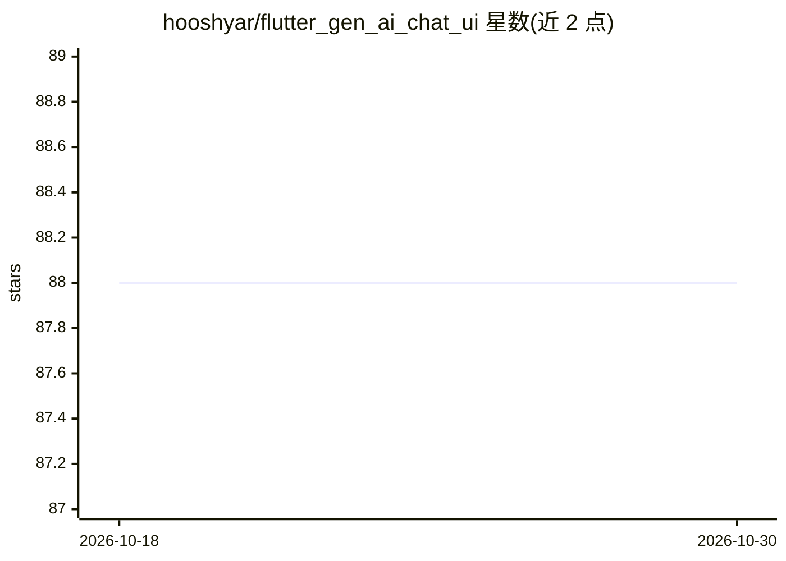

# hooshyar/flutter_gen_ai_chat_ui

⭐ 88 · Dart · MIT · 推送 2026-10-20 · [GitHub](https://github.com/hooshyar/flutter_gen_ai_chat_ui) · [官网](https://www.dilacode.com) · 个人维护

**面向 AI 应用的 Flutter 聊天 UI 组件包**

Flutter 聊天 UI 组件库，为含 LLM 的应用设计：开发者自行提供模型调用，包负责会话界面——逐词流式渲染 Markdown（语法高亮代码、LaTeX）、工具调用与函数执行 UI、富内联组件、人类确认对话框、RTL 双向文本、附件上传与语音切换等。后端无关，提供 OpenAI/Anthropic/Gemini/Ollama 的流式接入示例。通过 pub.dev 以依赖方式安装，附带网页示例应用与 Cookbook。

## 筛选速览

| 维度 | 判定 | 备注 |
|---|---|---|
| AI 角色 | `ai-ecosystem` | LLM/agent 周边工具 |
| 许可风险 | `permissive` | MIT |
| 部署形态 | `None` |  |
| 模型依赖 | local-ok | 支持本地模型 |
| 硬件要求 | — | 无带数字的原话,不猜 |
| 安装摩擦 | `low` | 无编译、无系统依赖或容器化 |
| 成熟度 | — | 结构信号不足 |

## 能力要点

- 逐词流式渲染 Markdown，含语法高亮代码块与 LaTeX
- AI Actions 系统：函数调用 UI、人类确认与实时执行状态
- ChatMessage.rich() 富内联组件与按类型注册的结果渲染器
- RTL 双向语言一级支持（阿拉伯语按整词流式）

## 适用场景

- 给我的 AI 应用快速搭建流式回答的聊天界面
- 渲染工具调用与富内容卡片（天气、图表等）
- 支持阿拉伯语等 RTL 语言的 AI 客服界面

## 场景标签

 · 领域:移动/跨平台应用 UI 组件

## 证据(README 行号)

> L8: A Flutter chat UI kit for AI apps. Stream ChatGPT, Claude or Gemini replies as live markdown with syntax-highlighted
> L48: Three Flutter chat UI packages dominate searches: `flutter_gen_ai_chat_ui`, `flutter_chat_ui`, and `dash_chat_2`. T

## 星数曲线

2026-10-18 88 → 2026-10-30 88（+0）

---
*卡片 v1 · prompt 1.4 · 生成 2026-10-23 · 置信度 high · 依据 README sha `c73ce8582876` · [字段定义](../../DATASET.md)*
