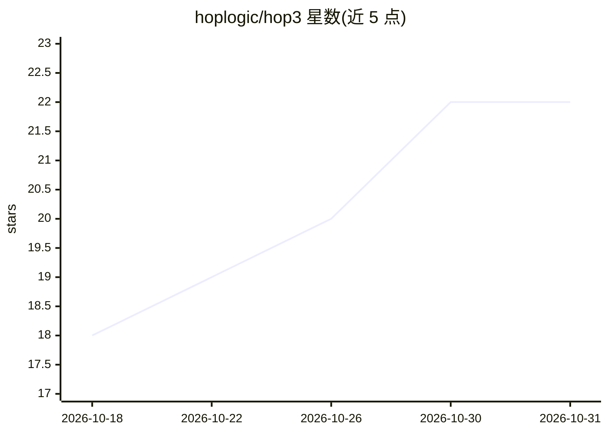

# hoplogic/hop3

⭐ 22 · TypeScript · MPL-2.0 · 推送 2026-10-12 · [GitHub](https://github.com/hoplogic/hop3) · 个人维护 · 中文 README

**面向 LLM Agent 的任务规约语言与执行引擎**

HOP 3.0 由语言层（HopSpec，用 markdown 声明任务结构：步骤、数据流、人机介入点）与执行引擎 HopJIT（npm 包 @hoplogic/hopjit）组成，另含可复用流程元件 HopAnt。复用模式下由本机 coding agent 作推理引擎、HopJIT 管顺序/核验/进度，不需要 API key；独立模式由 HopJIT 自行调用模型 API 执行规约。hopjit setup 探测 Claude Code / Codex / opencode 并安装 /hop 命令、注册 MCP server。面向使用 AI coding agent 的开发者，许可为 MPL-2.0。

## 筛选速览

| 维度 | 判定 | 备注 |
|---|---|---|
| AI 角色 | `ai-ecosystem` | LLM/agent 周边工具 |
| 许可风险 | `permissive` | MPL-2.0 |
| 部署形态 | `library` | 以包/库形式分发 |
| 模型依赖 | — | README 未给出锁定关系 |
| 硬件要求 | — | 无带数字的原话,不猜 |
| 安装摩擦 | `low` | 无编译、无系统依赖或容器化 |
| 成熟度 | — | 结构信号不足 |

## 能力要点

- HopSpec 用 markdown 声明任务结构，引擎强制执行循环、门禁与人机检查点
- 复用模式复用本机 coding agent、无需 API key；独立模式由引擎自调模型 API
- hopjit setup 自动探测 Claude Code/Codex/opencode 并注册 MCP server
- HopAnt 流程元件可总结、复用与分享给他人安装

## 适用场景

- 把自然语言 Skill 翻译成引擎强制执行的规约
- 让 coding agent 按任务卡逐步推进并在核验点停下
- 把重复工作沉淀为可分享复用的 HopAnt 流程元件

## 场景标签

`Agent 框架` `编码 Agent` · 领域:Agent 开发

## 证据(README 行号)

> L3: > **HOP** is a dual-mode language & runtime for LLM agents: declare tasks as structured markdown specs (HopSpec), ex
> L62: |**HopJIT**|hoplogic 项目里的 HopSpec 执行引擎（npm 包 `@hoplogic/hopjit`、命令 `hopjit`）——负责执行状态管理、变量存储、retry/adaptive 修复、None 
> L67: - **复用模式**（缺省）：你的 coding agent 当推理引擎，HopJIT 只管顺序、核验和进度。**不需要任何 API key。**

## 星数曲线

2026-10-18 18 → 2026-10-31 22（+4）

---
*卡片 v1 · prompt 1.4 · 生成 2026-10-28 · 置信度 high · 依据 README sha `73e15c90bf5b` · [字段定义](../../DATASET.md)*
