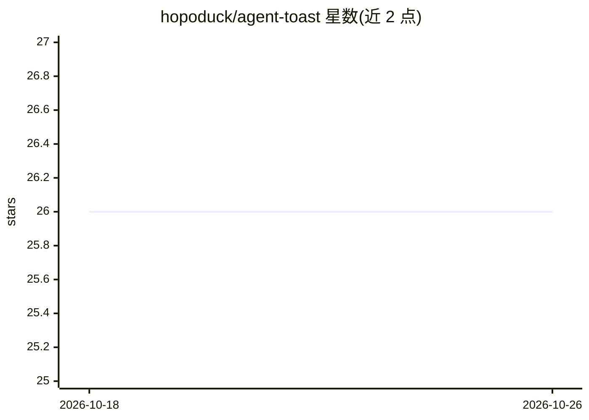

# hopoduck/agent-toast

⭐ 26 · Rust · MIT · 推送 2026-10-13 · [GitHub](https://github.com/hopoduck/agent-toast) · [官网](https://github.com/hopoduck/agent-toast/releases/latest) · 个人维护

**给终端 AI 编码代理用户的桌面通知工具：代理需要你时点击回到终端**

面向使用 Claude Code 与 Codex CLI 的开发者的 Windows 桌面通知应用：通过注册代理的钩子事件（15 种，含任务完成、权限请求、输入等待），在代理需要人工介入时弹出通知，点击即激活对应终端窗口，回到终端时通知自动消失。支持远程 Linux 服务器经 HTTP 接收通知、多显示器四角定位、通知统计与匿名全球统计。基于 Rust + Tauri + Vue.js，从 Releases 下载安装包或用 pnpm 自行构建。

## 筛选速览

| 维度 | 判定 | 备注 |
|---|---|---|
| AI 角色 | `ai-ecosystem` | LLM/agent 周边工具 |
| 许可风险 | `permissive` | MIT |
| 部署形态 | `desktop` | 安装包/桌面程序 |
| 模型依赖 | — | README 未给出锁定关系 |
| 硬件要求 | — | 无带数字的原话,不猜 |
| 安装摩擦 | `low` | 无编译、无系统依赖或容器化 |
| 成熟度 | — | 结构信号不足 |

## 能力要点

- 15 种钩子事件通知，通知正文显示代理最后一条消息
- 点击通知激活发起终端窗口，回到终端自动消隐、已聚焦则跳过
- 远程 Linux 服务器通知经 HTTP 接收（默认端口 38787，附带 agent-toast-send CLI）
- 通知设计实时预览自定义、通知统计、一键自动更新

## 适用场景

- 挂后台跑 Claude Code/Codex CLI，需要批准权限时第一时间收到提醒
- 在远程 Linux 服务器上跑代理，桌面端接收完成/权限通知
- 多终端多显示器并行开发，点通知直达对应窗口

## 场景标签

 · 领域:开发者工具/桌面通知

## 证据(README 行号)

> L22: - 작업 완료·권한 요청·입력 대기·세션 시작/종료 등 **15가지 훅 이벤트**
> L42: |Claude Code|Anthropic의 AI 코딩 어시스턴트|
> L43: |Codex CLI|OpenAI의 터미널 기반 코딩 에이전트|

## 星数曲线

2026-10-18 26 → 2026-10-26 26（+0）

---
*卡片 v1 · prompt 1.4 · 生成 2026-10-26 · 置信度 mid · 依据 README sha `8630d717b223` · [字段定义](../../DATASET.md)*
