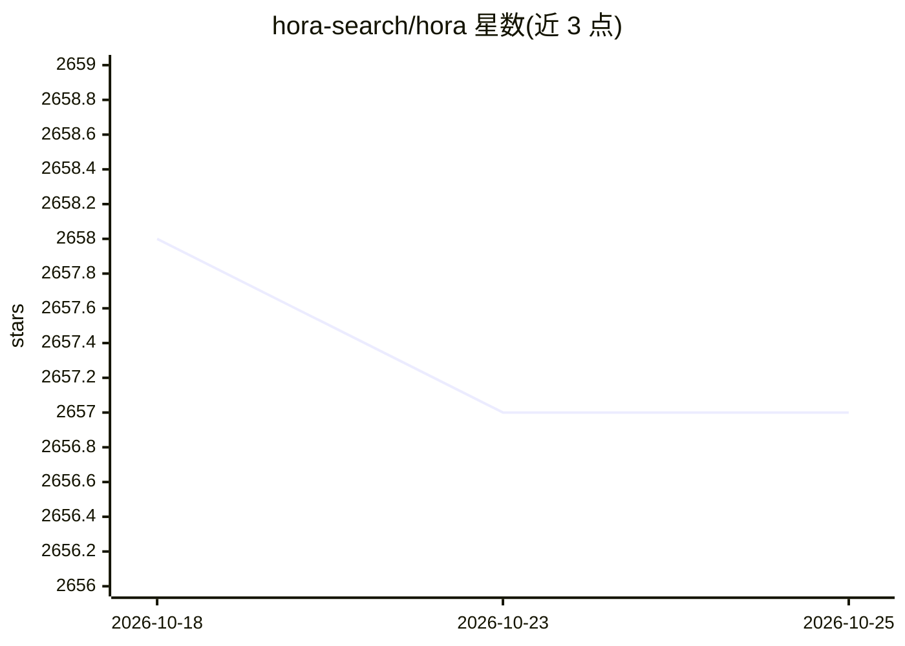

# hora-search/hora

⭐ 2,657 · Rust · Apache-2.0 · 推送 2026-02-17 · [GitHub](https://github.com/hora-search/hora) · [官网](http://horasearch.com/) · 组织维护

**Rust 编写的近似最近邻搜索（ANN）算法库**

纯 Rust 实现的近似最近邻搜索算法库，提供 HNSW、SSG、PQIVF、BruteForce 等多种索引（Random Projection Tree 为 WIP），支持点积、欧氏、曼哈顿、余弦等距离度量。面向需要向量检索能力的开发者，可通过 Python（horapy）、JavaScript（WebAssembly）、Java、Go 等多语言绑定使用，也可作为服务运行。SIMD 加速、多线程设计，不依赖 BLAS 等重型依赖。提供在线 Demo（人脸匹配、酒评搜索）。

## 筛选速览

| 维度 | 判定 | 备注 |
|---|---|---|
| AI 角色 | `ai-ecosystem` | LLM/agent 周边工具 |
| 许可风险 | `permissive` | Apache-2.0 |
| 部署形态 | `library` | 以包/库形式分发 |
| 模型依赖 | — | README 未给出锁定关系 |
| 硬件要求 | — | 无带数字的原话,不猜 |
| 安装摩擦 | `low` | 无编译、无系统依赖或容器化 |
| 成熟度 | — | 结构信号不足 |

## 能力要点

- HNSW/SSG/PQIVF/BruteForce 等多种 ANN 索引实现
- Python/JavaScript/Java 等多语言绑定，支持 WebAssembly 与服务化
- SIMD 加速与多线程设计，无 BLAS 等重型依赖
- 支持 4 种距离度量（点积/欧氏/曼哈顿/余弦）

## 适用场景

- 为推荐系统、图像检索等应用提供向量近似最近邻检索
- 通过 Python/JS 绑定在多语言项目中嵌入 ANN 能力
- 在浏览器端（WebAssembly）运行向量搜索

## 场景标签

`向量数据库` · 领域:知识与检索

## 证据(README 行号)

> L9: Hora is an **approximate nearest neighbor search algorithm** (wiki) library. We implement all code in `Rust🦀` for re
> L39: - **Supports Multiple Indexes** 🚀

## 星数曲线

2026-10-18 2,658 → 2026-10-25 2,657（-1）

---
*卡片 v1 · prompt 1.4 · 生成 2026-10-21 · 置信度 high · 依据 README sha `5b902432a51c` · [字段定义](../../DATASET.md)*
