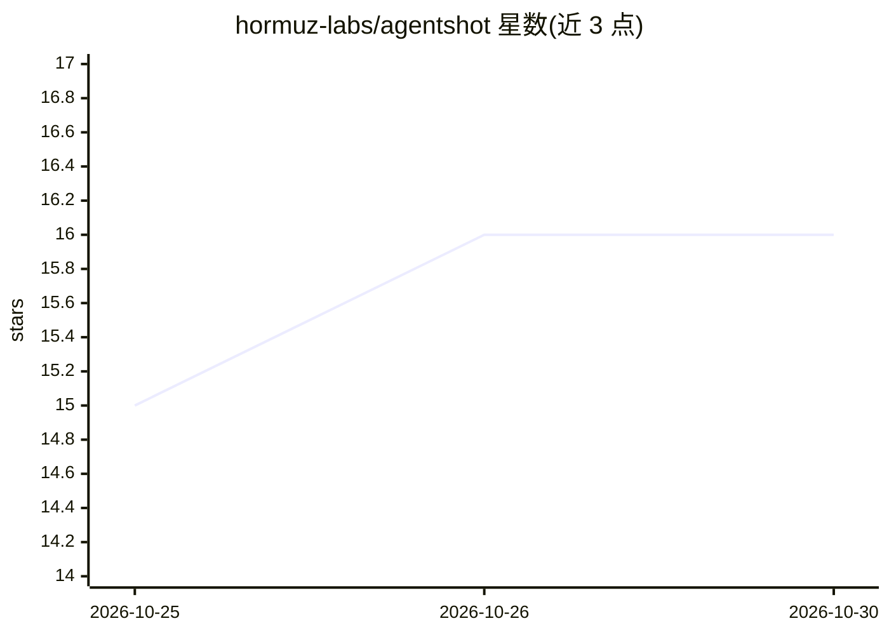

# hormuz-labs/agentshot

⭐ 16 · TypeScript · GPL-3.0 · 推送 2026-10-29 · [GitHub](https://github.com/hormuz-labs/agentshot) · [官网](https://agentshot.si) · 组织维护

**对话式 AI 视频编辑器：用语音/文字给剪辑指令**

面向终端用户的开源视频编辑器：导入素材后通过对话下指令，在画面上画框、在时间轴上拖选或打字说明，由 agent 执行剪辑；每次修改生成可前后对比的新版本，不覆盖原素材。剪辑与转录在本地计算机运行，AI 模型采用自带 key 方式（Claude、Gemini、GPT 或 OpenAI/Anthropic 兼容端点，按项目选择）。另含浏览器产品演示自动拍摄、动效示例库、手机伴侣应用与 AgentShot Cloud 云端工作节点。提供 macOS/Windows/Linux 安装包，手机端需自行构建。

## 筛选速览

| 维度 | 判定 | 备注 |
|---|---|---|
| AI 角色 | `ai-native` | 本体是模型或模型工具 |
| 许可风险 | `viral` | GPL-3.0 |
| 部署形态 | `desktop` | 安装包/桌面程序 |
| 模型依赖 | — | README 未给出锁定关系 |
| 硬件要求 | — | 无带数字的原话,不猜 |
| 安装摩擦 | `medium` | 含编译或系统依赖之一 |
| 成熟度 | `idea` | |

## 能力要点

- 按词级转录时间点对齐的精确剪切（静音间隙切点）
- 本地运行剪辑与转录，AI 只接收文本与静帧
- 每次编辑生成 before/after 新版本，不覆盖原素材
- 支持 16:9/9:16/1:1 多画幅输出并自动跟随人物裁切

## 适用场景

- 不会用时间轴的用户用对话完成视频剪辑
- 口播视频去口癖词、加字幕与背景音乐
- 竖屏 Shorts/Reels 版本一键转换并内嵌字幕
- 用浏览器自动录制并剪辑产品演示视频

## 场景标签

`视频生成` `浏览器自动化` · 领域:效率与自动化

## 证据(README 行号)

> L26: AgentShot is **a video editor you direct by talking**. Drop in your footage, say what you want, and point at the fr
> L130:  Every film in the sidebar, and any model Open projects keep working in the background. Claude, Gemini or GPT, or 

## 星数曲线

2026-10-25 15 → 2026-10-30 16（+1）

---
*卡片 v1 · prompt 1.4 · 生成 2026-10-30 · 置信度 high · 依据 README sha `35b5abd9b88c` · [字段定义](../../DATASET.md)*
