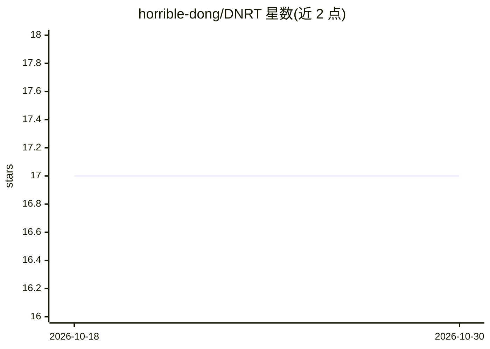

# horrible-dong/DNRT

⭐ 17 · Python · Apache-2.0 · 推送 2025-11-26 · [GitHub](https://github.com/horrible-dong/DNRT) · [官网](https://openreview.net/pdf?id=HiTg16qhxp) · 组织维护

**ICLR 2024 论文代码：仿生动态神经响应调节机制 DNRT**

浙江大学团队 ICLR 2024 论文 Dynamic Neural Response Tuning 的官方实现：提出由 Response-Adaptive Activation（按输入特征与强度动态调整响应条件）和 Aggregated Response Regularization（约束响应分布以学习类别特异性）组成的 DNRT 机制，用于替换静态激活，可应用于多种主流网络架构。提供基于 PyTorch 的训练/评测代码，支持单卡与多卡（torchrun），cifar10/cifar100 自动下载，Apache 2.0 许可。开发环境为 python 3.7 + pytorch 1.11.0+cu113。

## 筛选速览

| 维度 | 判定 | 备注 |
|---|---|---|
| AI 角色 | `ai-native` | 本体是模型或模型工具 |
| 许可风险 | `permissive` | Apache-2.0 |
| 部署形态 | `library` | 以包/库形式分发 |
| 模型依赖 | — | README 未给出锁定关系 |
| 硬件要求 | — | 无带数字的原话,不猜 |
| 安装摩擦 | `medium` | 含编译或系统依赖之一 |
| 成熟度 | — | 结构信号不足 |

## 能力要点

- RAA 按输入信号特征与强度动态调整激活响应条件
- ARR 约束网络响应分布以增强类别特异性
- 支持单卡与多卡（torchrun）训练与评测
- cifar10/cifar100 训练时自动下载

## 适用场景

- 复现论文中 DNRT 机制的实验结果
- 在自己的网络架构中尝试动态激活机制
- 基于代码开展激活函数/神经响应方向的后续研究

## 场景标签

 · 领域:深度学习/神经表征研究

## 证据(README 行号)

> L22: these biological patterns, we propose a novel Dynamic Neural Response Tuning (DNRT) mechanism, which aligns the res
> L24: Response Regularization (ARR), mimicking the biological neuron's information transmission and aggregation behaviors

## 星数曲线

2026-10-18 17 → 2026-10-30 17（+0）

---
*卡片 v1 · prompt 1.4 · 生成 2026-10-29 · 置信度 high · 依据 README sha `bbb7564deac9` · [字段定义](../../DATASET.md)*
