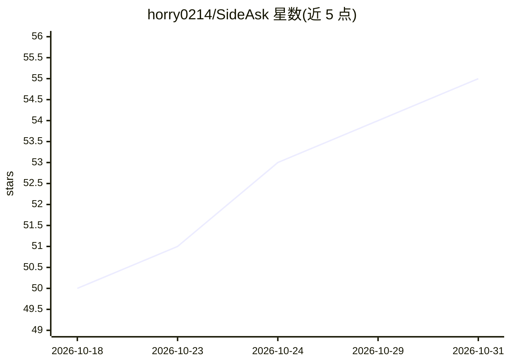

# horry0214/SideAsk

⭐ 55 · JavaScript · MIT · 推送 2026-08-29 · [GitHub](https://github.com/horry0214/SideAsk) · 个人维护 · 中文 README

**浏览器即选即问的 AI 释义层：划词提问不切页**

以 Manifest V3 浏览器扩展为主体的划词 AI 解释工具：在网页中选中 2–500 字符即可就地解释、追问并返回原文，另提供可选的 Windows 桌面伴侣（WebView2 覆盖层、Alt+Shift+A 全局快捷键）覆盖浏览器扩展无法触及的应用。BYOK 模式内置 25 个 Provider 预设（OpenAI/Anthropic/Gemini/Ollama 等），密钥经本地 Gateway（127.0.0.1:8787）加密存储，仅发送选中内容及最小邻近上下文。零运行时依赖，历史与收藏存于本地 IndexedDB。

## 筛选速览

| 维度 | 判定 | 备注 |
|---|---|---|
| AI 角色 | `ai-native` | 本体是模型或模型工具 |
| 许可风险 | `permissive` | MIT |
| 部署形态 | `desktop` | 安装包/桌面程序 |
| 模型依赖 | — | README 未给出锁定关系 |
| 硬件要求 | — | 无带数字的原话,不猜 |
| 安装摩擦 | `low` | 无编译、无系统依赖或容器化 |
| 成熟度 | — | 结构信号不足 |

## 能力要点

- 选中 2–500 字符就地解释、追问并返回原文，避免上下文切换
- 25 个 Provider 预设的 BYOK 目录，密钥在本地 Gateway 加密保存
- 本地优先：Gateway 仅绑定 loopback，仅发送选中内容与最小邻近上下文
- 可选 Windows 桌面伴侣复用 WebView2 与共享 Provider Vault

## 适用场景

- 读文档或论文时遇到不理解的术语，就地提问不打断阅读
- 在 ChatGPT/Claude 长回答中选中一句就地澄清
- 在 VS Code、PDF、终端等 Windows 应用中划词解释
- 用自己的 API key 或本地 Ollama 获取解释，数据不离开本机

## 场景标签

`AI 助手` · 领域:对话与助手

## 证据(README 行号)

> L4:  A browser-first AI explanation layer, with an optional Windows companion that brings the same flow anywhere.
> L33: Select 2–500 characters and choose **✦ Explain**. SideAsk sends only the minimum nearby context needed, streams a s

## 星数曲线

2026-10-18 50 → 2026-10-31 55（+5）

---
*卡片 v1 · prompt 1.4 · 生成 2026-10-24 · 置信度 high · 依据 README sha `e03b5bb9ecbe` · [字段定义](../../DATASET.md)*
