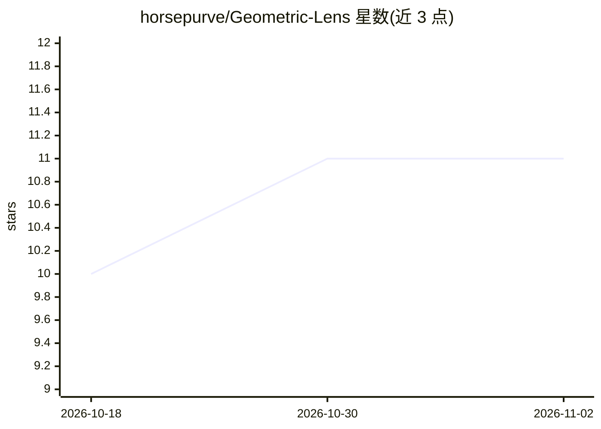

# horsepurve/Geometric-Lens

⭐ 11 · Jupyter Notebook · MIT · 推送 2026-07-17 · [GitHub](https://github.com/horsepurve/Geometric-Lens) · 个人维护

**用几何方法可视化 LLM 决策边界与推理轨迹的研究代码**

论文 'Laguerre Geometry for Interpreting Large Language Models' 的配套代码，以 Jupyter Notebook 形式提供。核心是 Geometric Lens：读取模型隐藏层表征，结合 Logit Lens、Patchscopes 在二维平面联合可视化 LLM 的决策边界与上下文干扰下的推理轨迹；另含复现 Anthropic Jacobian Lens 的 notebook。依赖 numpy/torch/transformers/accelerate，通过 pip 安装后逐个运行 notebook。面向可解释性研究人员。

## 筛选速览

| 维度 | 判定 | 备注 |
|---|---|---|
| AI 角色 | `ai-ecosystem` | LLM/agent 周边工具 |
| 许可风险 | `permissive` | MIT |
| 部署形态 | `library` | 以包/库形式分发 |
| 模型依赖 | — | README 未给出锁定关系 |
| 硬件要求 | — | 无带数字的原话,不猜 |
| 安装摩擦 | `low` | 无编译、无系统依赖或容器化 |
| 成熟度 | — | 结构信号不足 |

## 能力要点

- Geometric Lens 读取隐藏层表征进行可视化
- Logit Lens 与 Patchscopes 复现与对比 notebook
- 2D 平面联合展示决策边界与推理轨迹
- 含复现 Anthropic Jacobian Lens 的 notebook

## 适用场景

- 研究 LLM 决策边界与上下文干扰现象
- 对比多种 lens 方法的可视化结果
- 复现论文实验与图表

## 场景标签

`科研工具` · 领域:学习与行业

## 证据(README 行号)

> L1: # Joint visualization of LLM decision boundaries and reasoning trajectories by Geometric Lens and Laguerre Geometry
> L17: 3. Run Geometric Lens (ours): \

## 星数曲线

2026-10-18 10 → 2026-11-02 11（+1）

---
*卡片 v1 · prompt 1.4 · 生成 2026-11-02 · 置信度 high · 依据 README sha `329a8a01c2ad` · [字段定义](../../DATASET.md)*
