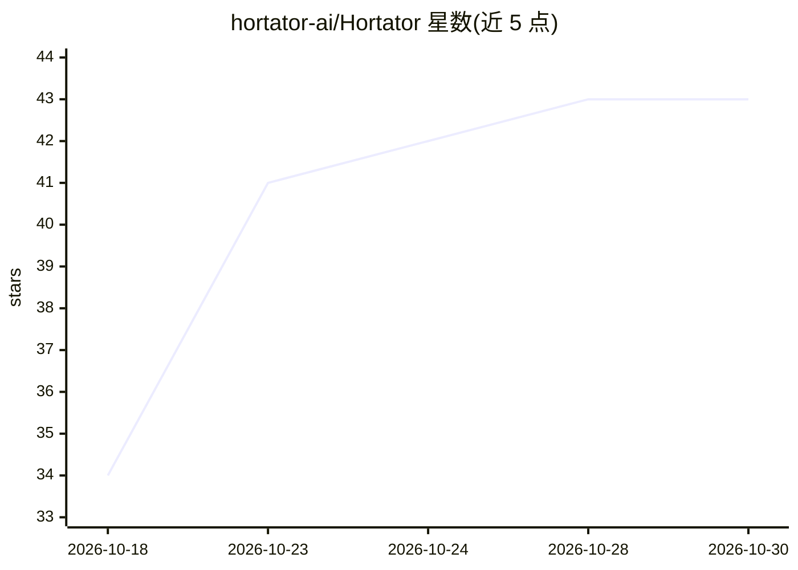

# hortator-ai/Hortator

⭐ 43 · Go · MIT · 推送 2026-06-21 · [GitHub](https://github.com/hortator-ai/Hortator) · [官网](https://hortator.ai) · 组织维护

**让 AI agent 在 K8s 上受控派生子 agent 的 Kubernetes operator**

用 Go 编写的 Kubernetes operator，使 AI agent 能在运行时通过 CLI（hortator spawn/result）派生子 agent，形成动态任务层级（Tribune/Centurion/Legionary 三层）。每个 agent 运行在独立 Pod，operator 负责生命周期、父子结果传递（inbox/outbox/memory/workspace 挂载）、上下文耗尽时的检查点重生。内置护栏：能力继承与网络策略、按能力 RBAC、token/成本预算（LiteLLM 价格表）、Presidio PII 脱敏、卡住检测、Prometheus/OpenTelemetry 观测。面向平台工程师（Helm/YAML 配置）与 agent 本身（CLI）。运行时无关，任何容器化 agent 均可接入。需 Kubernetes 1.28+，通过 Helm chart 安装。

## 筛选速览

| 维度 | 判定 | 备注 |
|---|---|---|
| AI 角色 | `ai-ecosystem` | LLM/agent 周边工具 |
| 许可风险 | `permissive` | MIT |
| 部署形态 | `library` | 以包/库形式分发 |
| 模型依赖 | — | README 未给出锁定关系 |
| 硬件要求 | — | 无带数字的原话,不猜 |
| 安装摩擦 | `low` | 无编译、无系统依赖或容器化 |
| 成熟度 | — | 结构信号不足 |

## 能力要点

- agent 经 CLI 派生子 agent，任务树在运行时动态生成
- 每个 agent 独立 Pod，含能力继承、NetworkPolicy、per-capability RBAC
- token/成本上限与 BudgetExceeded 状态，LiteLLM 价格表自动计费
- Presidio sidecar 做 PII/密钥输入输出脱敏；上下文耗尽时检查点重生

## 适用场景

- 在 Kubernetes 上运行需要多层派生的自主 agent 任务
- 为生产环境 agent 加预算、隔离与脱敏等护栏
- 在 Hortator agent 内部继续运行 CrewAI/LangChain 框架

## 场景标签

`Agent 框架` `多智能体` · 领域:Agent 开发

## 证据(README 行号)

> L29: Hortator is a **Kubernetes operator** that gives AI agents the ability to create other AI agents at runtime - formi
> L252: No. Hortator is infrastructure, not intelligence. It prevents good agents from failing for infrastructure reasons:

## 星数曲线

2026-10-18 34 → 2026-10-30 43（+9）

---
*卡片 v1 · prompt 1.4 · 生成 2026-10-25 · 置信度 high · 依据 README sha `9a86a4f50331` · [字段定义](../../DATASET.md)*
