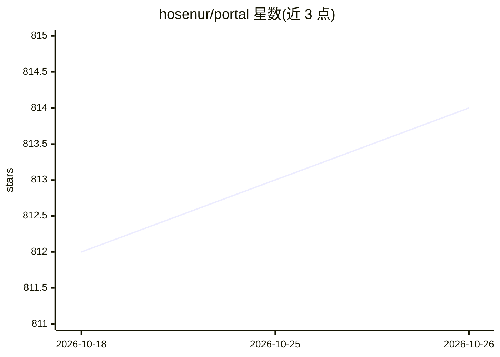

# hosenur/portal

⭐ 814 · TypeScript · MIT · 推送 2026-05-12 · [GitHub](https://github.com/hosenur/portal) · [官网](https://openportal.space) · 个人维护

**面向移动端的 OpenCode AI 编码代理 Web UI，支持远程会话管理**

连接本地或远程 OpenCode 服务器的浏览器界面，提供会话管理、实时聊天、@文件引用、模型选择与深浅色主题；bunx 一条命令同时拉起 OpenCode 服务器（默认 4000 端口）与 Web UI（默认 3000 端口），端口占用时自动分配。作者因 OpenCode 官方 Web UI 缺少移动端响应式而开发此项目，典型部署方式是 VPS + Tailscale 从手机远程访问。注意：本产品为个人项目，非 SST/OpenCode 官方出品，且系统需先安装 OpenCode。

## 筛选速览

| 维度 | 判定 | 备注 |
|---|---|---|
| AI 角色 | `ai-ecosystem` | LLM/agent 周边工具 |
| 许可风险 | `permissive` | MIT |
| 部署形态 | `None` |  |
| 模型依赖 | — | README 未给出锁定关系 |
| 硬件要求 | — | 无带数字的原话,不猜 |
| 安装摩擦 | `low` | 无编译、无系统依赖或容器化 |
| 成熟度 | — | 结构信号不足 |

## 能力要点

- 移动优先的响应式 Web UI，管理 OpenCode 会话与聊天
- bunx 一条命令同时启动 OpenCode 服务器与 Web UI，端口自动分配
- 支持 @filename 文件引用与模型选择
- 提供实例管理 CLI（run/stop/list/clean）

## 适用场景

- 在手机上远程访问部署在 VPS 的 OpenCode 实例
- 通过浏览器管理多个 OpenCode 会话并与 AI 助手对话
- 配合 Tailscale 等 VPN 安全地远程写代码

## 场景标签

`编码 Agent` · 领域:编码与开发

## 证据(README 行号)

> L7: A web-based UI for OpenCode, the AI coding agent. This portal provides a browser interface to interact with OpenCode
> L75: OpenCode Portal connects to a running OpenCode server and provides:

## 星数曲线

2026-10-18 812 → 2026-10-26 814（+2）

---
*卡片 v1 · prompt 1.4 · 生成 2026-10-21 · 置信度 high · 依据 README sha `cb4eaec377ee` · [字段定义](../../DATASET.md)*
