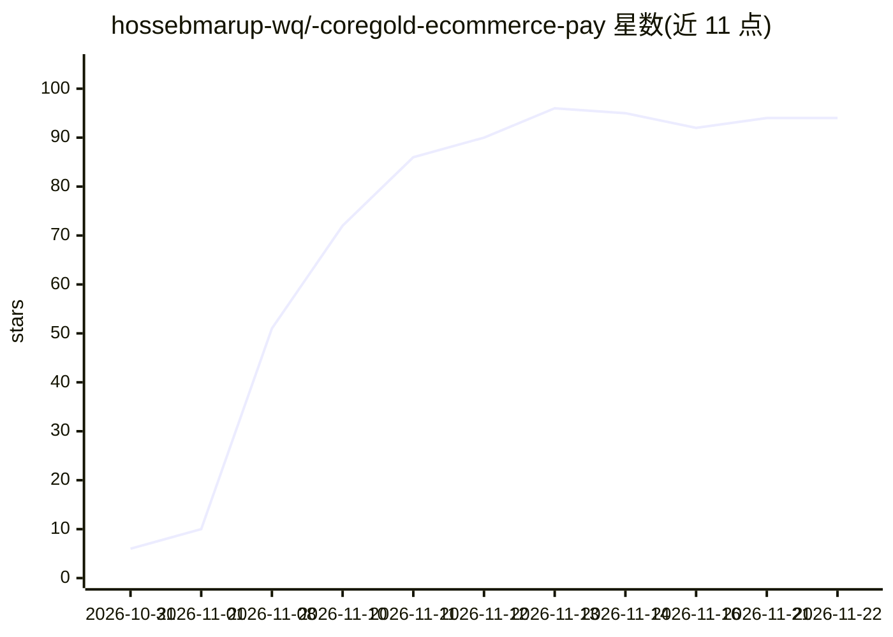

# hossebmarup-wq/-coregold-ecommerce-pay

⭐ 94 · 推送 2026-10-30 · [GitHub](https://github.com/hossebmarup-wq/-coregold-ecommerce-pay) · [官网](https://app.coregold.io/signup?invite_code=ADvlj9b) · 组织维护 · 中文 README

**跨境卖家海外虚拟卡服务的推广页，非软件项目**

仓库 README 为 CoreGold 虚拟卡服务的中文营销文案：面向跨境电商与独立站卖家，宣传海外商用 Visa/Mastercard 虚拟卡，USDT 充值转美元，一店一卡隔离，用于 Shopify 店租扣款、AliExpress/CJ 一件代发采购、海外运营杂费支付等场景。仓库不含任何代码、安装说明或技术文档，主题标签中的 ai 与内容无对应。本质是商业服务推广材料，非开源软件。

## 筛选速览

| 维度 | 判定 | 备注 |
|---|---|---|
| AI 角色 | `ai-enhanced` | 去掉 AI 部分产品仍成立 |
| 许可风险 | `none` | — |
| 部署形态 | `None` |  |
| 模型依赖 | — | README 未给出锁定关系 |
| 硬件要求 | — | 无带数字的原话,不猜 |
| 安装摩擦 | `low` | 无编译、无系统依赖或容器化 |
| 成熟度 | — | 结构信号不足 |

## 能力要点

- 宣传内容：海外商用虚拟卡，USDT 充值
- 宣传内容：一店一卡隔离、按店铺限额
- 仓库仅含营销文案，无代码或安装说明

## 适用场景

- 跨境卖家阅读虚拟卡服务介绍（推广内容）

## 场景标签

 · 领域:跨境支付服务（推广）

## 证据(README 行号)

> L1: # -coregold-ecommerce-pay
> L6: > **CoreGold** 为跨境卖家提供海外商用 Visa / Mastercard 虚拟卡，一店一卡独立隔离，USDT 充值即用，把店铺资产和资金链牢牢锁死在安全区。
> L37: 👉 **点击注册并进入 CoreGold 跨境发卡控制台**

## 星数曲线

2026-10-31 6 → 2026-11-22 94（+88）

---
*卡片 v1 · prompt 1.4 · 生成 2026-11-17 · 置信度 low · 依据 README sha `2513621655d1` · [字段定义](../../DATASET.md)*
