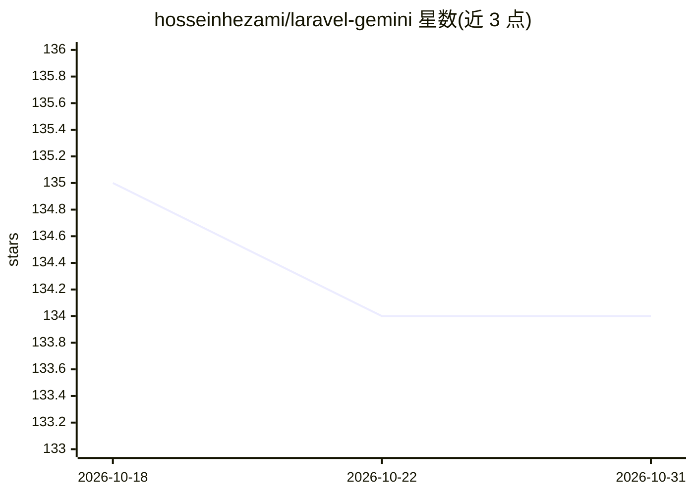

# hosseinhezami/laravel-gemini

⭐ 134 · PHP · MIT · 推送 2026-06-14 · [GitHub](https://github.com/hosseinhezami/laravel-gemini) · [官网](https://hosseinhezami.github.io/laravel-gemini) · 个人维护

**Laravel 框架接入 Google Gemini API 的 PHP 扩展包**

面向 Laravel 开发者的 Composer 扩展包，通过 Builder 风格 Facade（Gemini::text()/image()/video()/audio()/embeddings()/files()/caches()）封装 Google Gemini API 的调用。支持文本生成、图像/视频生成、TTS 音频合成、多模态文档理解、结构化 JSON 输出、流式响应、内容缓存与文件上传管理。API key 可从 .env 读取或运行时通过 setApiKey() 动态切换，配置项覆盖超时、重试策略与流式参数。需自备 Gemini API key。

## 筛选速览

| 维度 | 判定 | 备注 |
|---|---|---|
| AI 角色 | `ai-ecosystem` | LLM/agent 周边工具 |
| 许可风险 | `permissive` | MIT |
| 部署形态 | `None` |  |
| 模型依赖 | — | README 未给出锁定关系 |
| 硬件要求 | — | 无带数字的原话,不猜 |
| 安装摩擦 | `low` | 无编译、无系统依赖或容器化 |
| 成熟度 | — | 结构信号不足 |

## 能力要点

- Builder 风格 Facade 覆盖文本/图像/视频/音频/嵌入/文件/缓存七类能力
- structuredSchema() 生成带 schema 校验的结构化 JSON 输出
- API key 支持运行时动态切换（多用户/多请求场景）
- 抽象长任务（如视频生成）的轮询与保存流程

## 适用场景

- 在 Laravel 应用中接入 Gemini 实现聊天与文档理解
- 为多租户应用按用户切换 Gemini API key
- 利用缓存复用预处理内容以降低延迟与成本

## 场景标签

 · 领域:LLM API 集成/PHP 开发

## 证据(README 行号)

> L3: A production-ready Laravel package to integrate with the Google Gemini API. Supports text, image, video, audio, long
> L107: This package exposes a set of builder-style facades: `Gemini::text()`, `Gemini::image()`, `Gemini::video()`, `Gemi

## 星数曲线

2026-10-18 135 → 2026-10-31 134（-1）

---
*卡片 v1 · prompt 1.4 · 生成 2026-10-22 · 置信度 high · 依据 README sha `0d0ad0b73cc2` · [字段定义](../../DATASET.md)*
