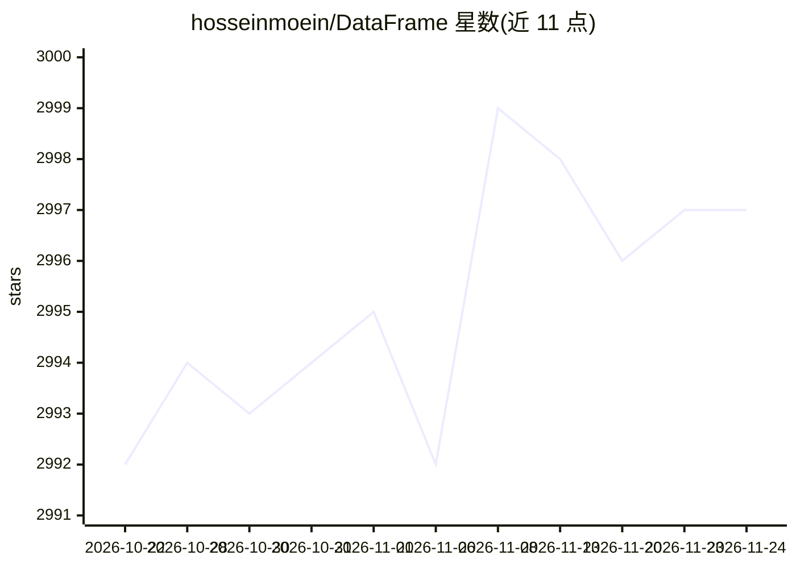

# hosseinmoein/DataFrame

⭐ 2,997 · C++ · BSD-3-Clause · 推送 2026-11-23 · [GitHub](https://github.com/hosseinmoein/DataFrame) · [官网](https://hosseinmoein.github.io/DataFrame/) · 个人维护

**C++ 数据分析库：供量化/数据科学场景做统计与表格计算**

模板化、异构的 C++ 内存表格容器，支持任意维度列（列可为任意类型向量，含嵌套 DataFrame），提供 join、merge、group-by、透视、多列排序等操作，并以 visitor 形式内置统计（均值/标准差/移动平均）、PCA、多项式拟合、FFT、特征值及交易指标等算法，可扩展自定义算法。API 大规模使用多线程以处理大数据集。库自包含，仅依赖 C++ 语言与标准库。面向数据科学家、量化交易员与 C++ 开发者，定位为在 C++ 中获得类似 Pandas/data.frame 的功能而不引入 Python 开销。

## 筛选速览

| 维度 | 判定 | 备注 |
|---|---|---|
| AI 角色 | `ai-native` | 本体是模型或模型工具 |
| 许可风险 | `permissive` | BSD-3-Clause |
| 部署形态 | `None` |  |
| 模型依赖 | — | README 未给出锁定关系 |
| 硬件要求 | — | 无带数字的原话,不猜 |
| 安装摩擦 | `low` | 无编译、无系统依赖或容器化 |
| 成熟度 | — | 结构信号不足 |

## 能力要点

- 任意维度异构列容器，列为一等公民，连续内存布局
- visitor 形式内置统计/金融/ML 算法集合（PCA、FFT、交易指标等）
- API 广泛多线程，面向大数据集分析
- 自包含：仅依赖 C++ 语言与标准库

## 适用场景

- 在 C++ 项目中做表格数据的统计分析与变换
- 量化交易中的金融指标计算与回测数据处理
- 大维度数据集的内存内探索与筛选

## 场景标签

`数据分析` `金融量化` · 领域:效率与自动化

## 证据(README 行号)

> L32: DataFrame is a high-performance C++ library for in-memory data exploration, transformation, and statistical analysi
> L36: DataFrame also includes a large collection of analytical algorithms in form of visitors. These are from basic stats

## 星数曲线

2026-10-22 2,992 → 2026-11-24 2,997（+5）

---
*卡片 v1 · prompt 1.4 · 生成 2026-11-23 · 置信度 high · 依据 README sha `a33cf3cf70c5` · [字段定义](../../DATASET.md)*
