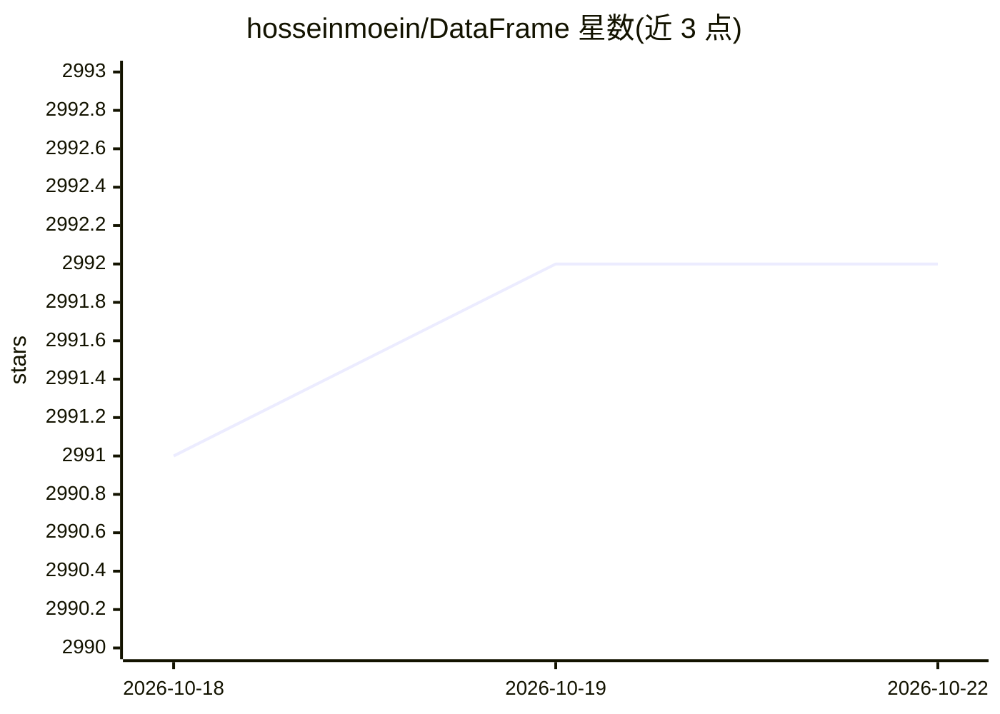

# hosseinmoein/DataFrame

⭐ 2,992 · C++ · BSD-3-Clause · 推送 2026-10-20 · [GitHub](https://github.com/hosseinmoein/DataFrame) · [官网](https://hosseinmoein.github.io/DataFrame/) · 个人维护

**面向统计分析与 ML 的 C++ 异构 DataFrame 容器库**

C++23 实现的模板化异构数据容器与分析库，面向数据科学家、量化交易者和 C++ 开发者。提供二维及多维数据结构，支持切片、join、merge、分组、透视与多列排序，内置大量访客（visitor）算法：基础统计、移动平均、PCA、多项式拟合、FFT、特征值及交易指标，并允许接入自定义算法。API 广泛使用多线程处理大数据集，仅依赖 C++ 标准库、自包含；需从源码编译，可通过 Conan Center 与 VCPKG 获取。README 含与 Polars/Pandas 的基准对比数据。

## 筛选速览

| 维度 | 判定 | 备注 |
|---|---|---|
| AI 角色 | `ai-ecosystem` | LLM/agent 周边工具 |
| 许可风险 | `permissive` | BSD-3-Clause |
| 部署形态 | `None` |  |
| 模型依赖 | — | README 未给出锁定关系 |
| 硬件要求 | — | 无带数字的原话,不猜 |
| 安装摩擦 | `low` | 无编译、无系统依赖或容器化 |
| 成熟度 | — | 结构信号不足 |

## 能力要点

- 列为一等公民，列可为任意类型向量（含嵌套 DataFrame），支持多维数据
- 内置统计/金融/ML 算法集（PCA、FFT、多项式拟合、交易指标等），可扩展自定义算法
- API 广泛多线程化，面向大数据集分析
- 自包含设计，仅依赖 C++ 语言与标准库

## 适用场景

- 在 C++ 项目中做表格数据的探索、转换与统计分析
- 量化交易场景下运行交易指标与金融分析算法
- 处理超出 Python 库内存承载能力的大规模数据集

## 场景标签

`数据分析` `金融量化` · 领域:效率与自动化

## 证据(README 行号)

> L32: DataFrame is a high-performance C++ library for in-memory data exploration, transformation, and statistical analysi
> L36: DataFrame also includes a large collection of analytical algorithms in form of visitors. These are from basic stats
> L49: 8. Keep DataFrame library self-contained, meaning DataFrame must only depend on _C++ language_ and its _standard li

## 星数曲线

2026-10-18 2,991 → 2026-10-22 2,992（+1）

---
*卡片 v1 · prompt 1.4 · 生成 2026-10-20 · 置信度 high · 依据 README sha `5cb05064e1e3` · [字段定义](../../DATASET.md)*
