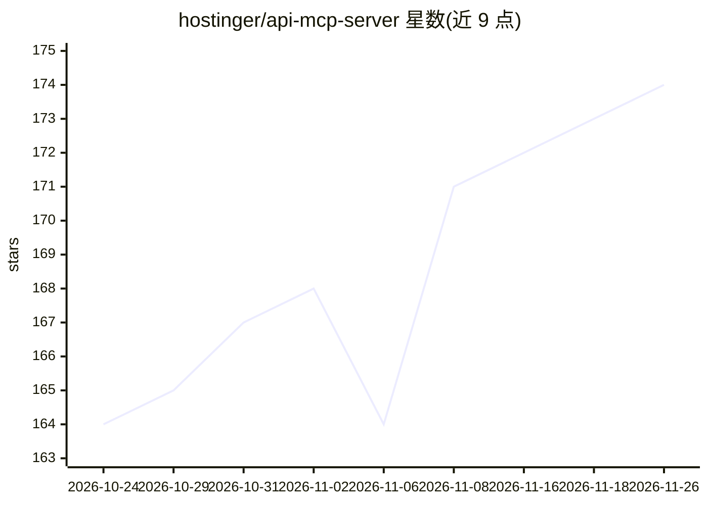

# hostinger/api-mcp-server

⭐ 174 · TypeScript · MIT · 推送 2026-11-25 · [GitHub](https://github.com/hostinger/api-mcp-server) · [官网](https://developers.hostinger.com) · 组织维护

**让 AI 客户端通过 MCP 调用 Hostinger API 的服务器**

Hostinger API 的 MCP 服务器，将 426 个 Hostinger 运维操作封装为 search/execute/multi-execute 三个工具，供 Claude、Cursor 等 MCP 兼容客户端调用，覆盖托管、VPS、域名、DNS、邮件、WordPress、账单等 14 个分组（提供分组范围的独立二进制）。支持远程托管服务器直连或本地 npm 安装；认证支持 API Token 与 OAuth 2.0 + PKCE，stdio 与 HTTP 两种传输模式。需 Node.js 24+。

## 筛选速览

| 维度 | 判定 | 备注 |
|---|---|---|
| AI 角色 | `ai-ecosystem` | LLM/agent 周边工具 |
| 许可风险 | `permissive` | MIT |
| 部署形态 | `library` | 以包/库形式分发 |
| 模型依赖 | — | README 未给出锁定关系 |
| 硬件要求 | — | 无带数字的原话,不猜 |
| 安装摩擦 | `low` | 无编译、无系统依赖或容器化 |
| 成熟度 | — | 结构信号不足 |

## 能力要点

- 将 426 个 Hostinger API 操作以 search/execute/multi-execute 三个 MCP 工具暴露
- 14 个按产品分组的二进制（hosting/vps/domains/dns/mail/wordpress 等）
- API Token 与 OAuth 2.0 + PKCE 两种认证方式，凭证自动存储与刷新
- 提供托管远程服务器（mcp.hostinger.com）免本地安装接入

## 适用场景

- 在 Claude Code 或 Cursor 中用自然语言管理 Hostinger 主机、VPS 与域名
- 脚本/CI 中通过 API Token 自动化 Hostinger 账单与 DNS 操作
- 按需只暴露某一产品分组（如仅 VPS）的 MCP 工具给客户端

## 场景标签

`工作流自动化` · 领域:效率与自动化

## 证据(README 行号)

> L3: Model Context Protocol (MCP) server for Hostinger API.
> L177: This server implements the Model Context Protocol (MCP) and can be used with any MCP-compatible consumer.
> L73: - `hostinger-api-mcp` — unified server over every operation (426 total)

## 星数曲线

2026-10-24 164 → 2026-11-26 174（+10）

---
*卡片 v1 · prompt 1.4 · 生成 2026-11-26 · 置信度 high · 依据 README sha `7a9acf529eef` · [字段定义](../../DATASET.md)*
