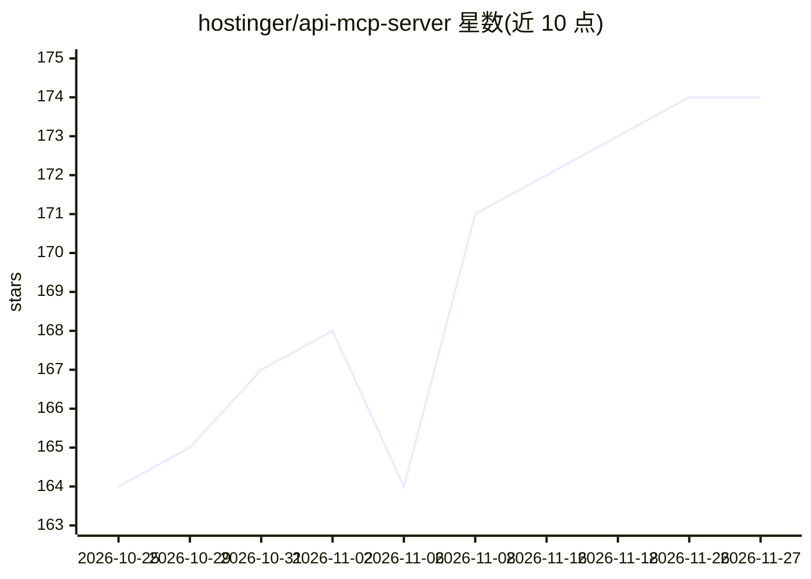

# hostinger/api-mcp-server

⭐ 174 · TypeScript · MIT · 推送 2026-11-26 · [GitHub](https://github.com/hostinger/api-mcp-server) · [官网](https://developers.hostinger.com) · 组织维护

**将 Hostinger API 以 MCP 工具暴露给 AI 客户端的服务器**

Hostinger 官方的 Model Context Protocol 服务器，把 Hostinger API 的 419 个操作包装为 search/execute/multi-execute 三个 MCP 工具，供 Claude Code、Codex、Cursor 等 MCP 兼容客户端调用，覆盖域名、DNS、VPS、主机、邮局、WordPress、账单、GPU 等分组。提供托管远程服务器（OAuth 授权）与本地 npm 安装两种方式；本地支持 stdio 与 Streamable HTTP 两种传输，认证支持 API Token 与 OAuth 2.0 with PKCE（自动刷新令牌、本地存储凭据）。运行需 Node.js 24+。

## 筛选速览

| 维度 | 判定 | 备注 |
|---|---|---|
| AI 角色 | `ai-ecosystem` | LLM/agent 周边工具 |
| 许可风险 | `permissive` | MIT |
| 部署形态 | `library` | 以包/库形式分发 |
| 模型依赖 | — | README 未给出锁定关系 |
| 硬件要求 | — | 无带数字的原话,不猜 |
| 安装摩擦 | `low` | 无编译、无系统依赖或容器化 |
| 成熟度 | — | 结构信号不足 |

## 能力要点

- 419 个 API 操作统一暴露为 search/execute/multi-execute 三个工具
- multi-execute 支持按序执行最多 20 个操作并在首个失败处停止
- 托管远程服务器 https://mcp.hostinger.com 无需本地安装
- 支持 stdio 与 Streamable HTTP 两种传输及 API Token/OAuth PKCE 双认证

## 适用场景

- 在 Claude Code 或 Cursor 中用自然语言管理 VPS、域名与主机
- 通过 API Token 在 CI/脚本中调用 Hostinger 操作
- 批量部署 Agency Plan 网站并管理域名绑定

## 场景标签

 · 领域:开发者工具/API 接入

## 证据(README 行号)

> L3: Model Context Protocol (MCP) server for Hostinger API.
> L73: - `hostinger-api-mcp` — unified server over every operation (419 total)
> L176: This server implements the Model Context Protocol (MCP) and can be used with any MCP-compatible consumer.

## 星数曲线

2026-10-25 164 → 2026-11-27 174（+10）

---
*卡片 v1 · prompt 1.4 · 生成 2026-11-27 · 置信度 high · 依据 README sha `60fed8409a89` · [字段定义](../../DATASET.md)*
