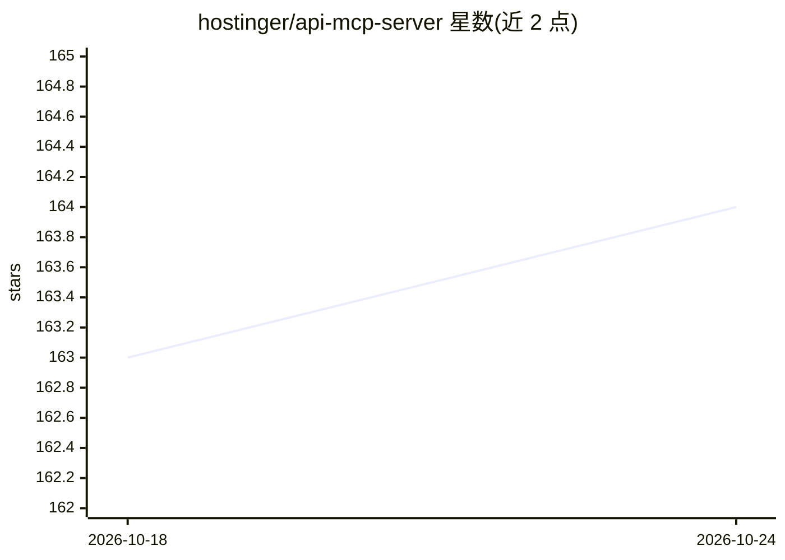

# hostinger/api-mcp-server

⭐ 164 · TypeScript · MIT · 推送 2026-10-23 · [GitHub](https://github.com/hostinger/api-mcp-server) · [官网](https://developers.hostinger.com) · 组织维护

**让 AI 客户端通过 MCP 操作 Hostinger 托管业务 API 的服务器**

Hostinger 官方发布的 Model Context Protocol 服务器，把 Hostinger API 的 409 个操作（托管、VPS、域名、DNS、邮件、WordPress、电商等 12 组）封装为 search/execute/multi-execute 三个 MCP 工具，供 Claude Code、Cursor 等 MCP 兼容客户端调用。提供托管远程服务器（mcp.hostinger.com，OAuth 授权）与本地 npm 安装两种方式；本地运行需 Node.js 24+，支持 stdio 与 HTTP 两种传输，认证可用 API Token 或 OAuth 2.0 with PKCE，按领域拆分为 12 个独立二进制。

## 筛选速览

| 维度 | 判定 | 备注 |
|---|---|---|
| AI 角色 | `ai-ecosystem` | LLM/agent 周边工具 |
| 许可风险 | `permissive` | MIT |
| 部署形态 | `library` | 以包/库形式分发 |
| 模型依赖 | — | README 未给出锁定关系 |
| 硬件要求 | — | 无带数字的原话,不猜 |
| 安装摩擦 | `low` | 无编译、无系统依赖或容器化 |
| 成熟度 | — | 结构信号不足 |

## 能力要点

- 统一服务器覆盖 409 个 Hostinger API 操作，另提供 12 个按领域拆分的独立二进制
- search / execute / multi-execute（最多 20 步、支持步骤间结果引用）三个 MCP 工具
- 支持 API Token 与 OAuth 2.0 with PKCE 两种认证，凭据本地加密存储
- 提供托管远程服务器 https://mcp.hostinger.com，可免本地安装直连

## 适用场景

- 在 Claude Code / Cursor 中通过对话管理 Hostinger 的主机、域名与 VPS
- 部署静态网站或 PHP 应用到 Hostinger Agency Plan
- 脚本/CI 中用 API Token 自动化执行 Hostinger 运维操作

## 场景标签

 · 领域:云托管/开发者工具

## 证据(README 行号)

> L3: Model Context Protocol (MCP) server for Hostinger API.
> L64: - `hostinger-api-mcp` — unified server over every operation (409 total)
> L165: This server implements the Model Context Protocol (MCP) and can be used with any MCP-compatible consumer.

## 星数曲线

2026-10-18 163 → 2026-10-24 164（+1）

---
*卡片 v1 · prompt 1.4 · 生成 2026-10-22 · 置信度 high · 依据 README sha `07bc1dcdd708` · [字段定义](../../DATASET.md)*
