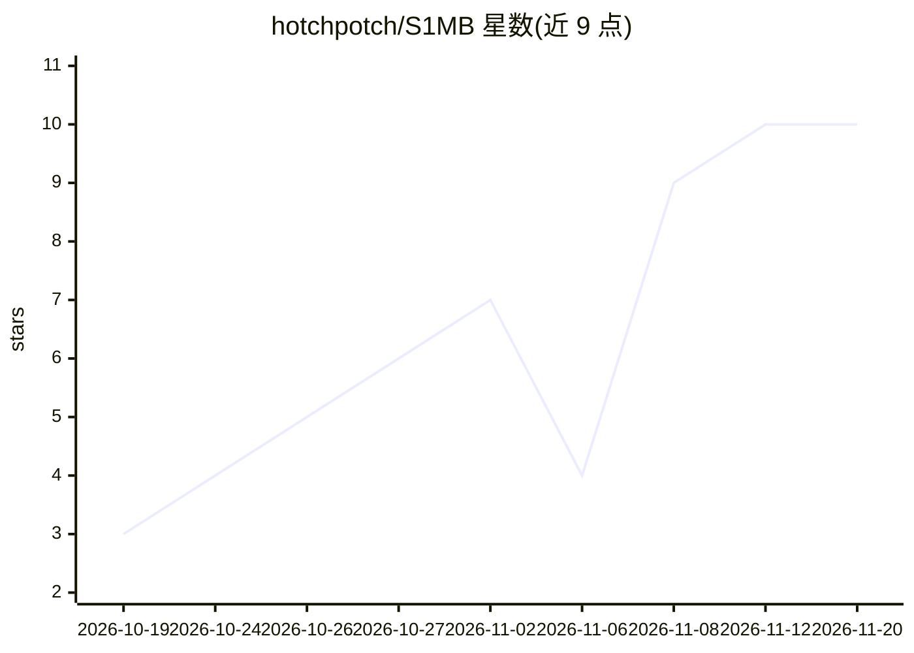

# hotchpotch/S1MB

⭐ 10 · Python · MIT · 推送 2026-11-12 · [GitHub](https://github.com/hotchpotch/S1MB) · 个人维护 · 中文 README

**为 System One 决策模型提供跨 100+ 基准的比较评测**

S1MB 是一个模型评测基准与排行榜项目，用统一输入与指标比较「System One 决策模型」在 Choice（选项选择）、Noul（是非判断）、Score（按标准打分）三类任务上的表现。包含英文 v1（137 个基准）、日文 v1（27 个基准）与 Vision v1（26 个图像基准，评测数据集私有需授权）。评测器为 Python 工具（uv 运行 s1mb CLI），结果提交为 Hugging Face Dataset PR；仓库另含 Next.js/TypeScript 查看器。README 明确说明分数不代表未见任务泛化能力。

## 筛选速览

| 维度 | 判定 | 备注 |
|---|---|---|
| AI 角色 | `ai-knowledge` | 知识聚合/清单类 |
| 许可风险 | `permissive` | MIT |
| 部署形态 | `None` |  |
| 模型依赖 | — | README 未给出锁定关系 |
| 硬件要求 | — | 无带数字的原话,不猜 |
| 安装摩擦 | `low` | 无编译、无系统依赖或容器化 |
| 成熟度 | — | 结构信号不足 |

## 能力要点

- 三类决策任务（Choice/Noul/Score）共用一套评测流程
- 英文/日文/视觉三个评测范围，通过 --category 选择
- 结果记录数据集与模型 revision、评测器来源与推理设置
- 社区结果经校验后导出为 Hugging Face Dataset PR

## 适用场景

- 把新模型在同一批基准上跑分并提交排行榜
- 查看某模型在各任务上的强项与弱项
- 为日文决策任务训练模型并声明训练暴露情况

## 场景标签

`模型评测` · 领域:评测与运维

## 证据(README 行号)

> L16: S1MB provides a practical reference point for comparing **System One Decision
> L39: tasks in a shared evaluation workflow. English v1 contains **137 benchmarks
> L42: Japanese v1 contains **27 Japanese benchmarks / 8,067 judgments**.

## 星数曲线

2026-10-19 3 → 2026-11-20 10（+7）

---
*卡片 v1 · prompt 1.4 · 生成 2026-11-19 · 置信度 high · 依据 README sha `15f979428b82` · [字段定义](../../DATASET.md)*
