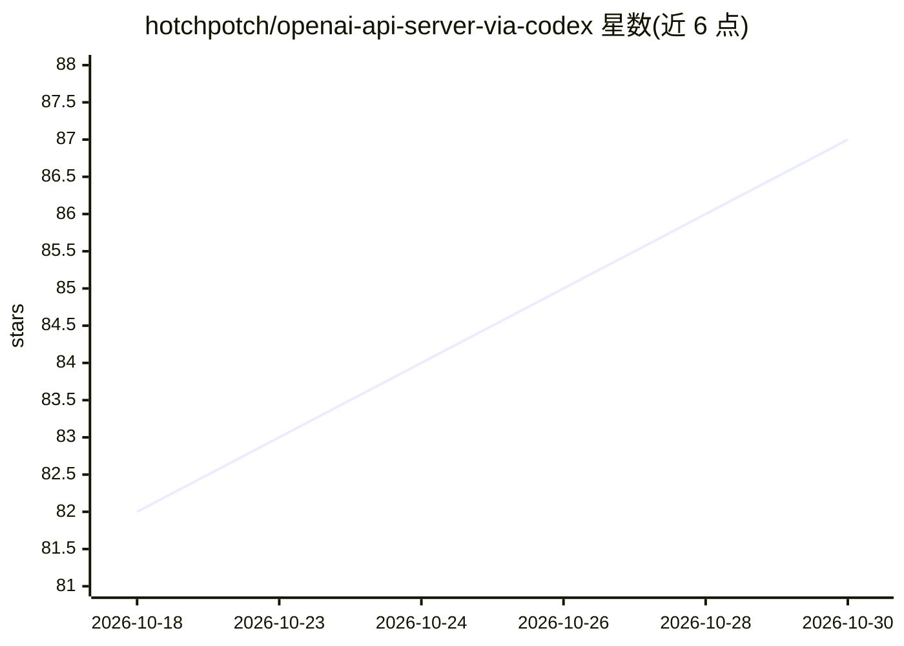

# hotchpotch/openai-api-server-via-codex

⭐ 87 · Go · Apache-2.0 · 推送 2026-10-24 · [GitHub](https://github.com/hotchpotch/openai-api-server-via-codex) · [官网]( ) · 个人维护

**将 ChatGPT/Codex 登录封装为本地 OpenAI 兼容 API 的 Go 代理服务器**

用 Go 实现的本地代理服务器，把 ChatGPT 订阅附带的 Codex 后端（经 ~/.codex/auth.json 的 ChatGPT 登录认证）暴露为 OpenAI 兼容 API，使现有 OpenAI SDK、LangChain、LiteLLM 等客户端只需改 base URL 即可使用。支持 Responses、Chat Completions、流式、工具调用、结构化输出、图像与音频。提供 uvx/wheel、独立二进制、Docker/GHCR、go install 多种分发方式；默认回环绑定与脱敏日志，可选入站 API key。限制：受 Codex 配额约束，上游后端可能变化，README 明确禁止公开暴露或转售。

## 筛选速览

| 维度 | 判定 | 备注 |
|---|---|---|
| AI 角色 | `ai-ecosystem` | LLM/agent 周边工具 |
| 许可风险 | `permissive` | Apache-2.0 |
| 部署形态 | `self-host` | docker 或自建部署 |
| 模型依赖 | — | README 未给出锁定关系 |
| 硬件要求 | — | 无带数字的原话,不猜 |
| 安装摩擦 | `low` | 无编译、无系统依赖或容器化 |
| 成熟度 | — | 结构信号不足 |

## 能力要点

- OpenAI 兼容 API：Responses、Chat Completions、流式、工具、结构化输出、图像与音频
- 凭 ChatGPT 登录的 Codex 配额运行，无需 OpenAI Platform API key
- Go 单二进制，录制基准中空闲内存约 8.3 MiB、启动约 10 ms
- 多种安装路径：uvx/wheel、独立压缩包、Docker/GHCR、go install、源码构建

## 适用场景

- 让已写好的 OpenAI SDK / LangChain / LiteLLM 代码改一个环境变量就切到 Codex 配额
- 给无法直连 Codex 后端的工具提供统一的本地 OpenAI 兼容端点
- 以容器方式部署轻量本地代理

## 场景标签

`模型网关` · 领域:Agent 开发

## 证据(README 行号)

> L9: talks to Codex clients. This server puts an OpenAI-compatible API in front of
> L117: - reuse code written for `openai-python`, LangChain, LiteLLM, or another client

## 星数曲线

2026-10-18 82 → 2026-10-30 87（+5）

---
*卡片 v1 · prompt 1.4 · 生成 2026-10-24 · 置信度 high · 依据 README sha `7497f50e63a2` · [字段定义](../../DATASET.md)*
