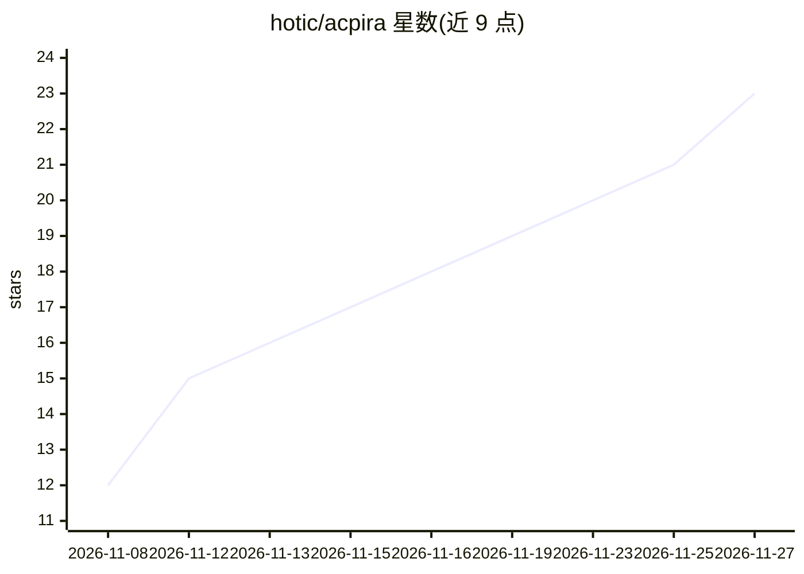

# hotic/acpira

⭐ 23 · Rust · MIT · 推送 2026-11-26 · [GitHub](https://github.com/hotic/acpira) · [官网](acpira.com) · 个人维护 · 中文 README

**跨多个编码 Agent 的原生工作台（Rust 内核，基于 ACP）**

以 Rust 编写、基于 ACP 的编码 Agent 工作台：既以官方登录与自有 harness 运行 Claude Code、Codex、Kimi Code 等 CLI Agent，也提供内置 Agent，可接任意 OpenAI/Anthropic 兼容端点执行读改代码、运行命令、搜索与规划。同一引擎驱动桌面应用、VS Code/Cursor/IntelliJ 插件与配对的 iPhone 应用；支持 @名 跨 Agent 委派、热插拔自扩展插件（逐版本确认可回滚）、SSH 远程目录与设备配对。桌面版目前提供 macOS/Windows 构建，iPhone 应用测试中未上架，Linux 桌面构建未发布。

## 筛选速览

| 维度 | 判定 | 备注 |
|---|---|---|
| AI 角色 | `ai-ecosystem` | LLM/agent 周边工具 |
| 许可风险 | `permissive` | MIT |
| 部署形态 | `desktop` | 安装包/桌面程序 |
| 模型依赖 | — | README 未给出锁定关系 |
| 硬件要求 | — | 无带数字的原话,不猜 |
| 安装摩擦 | `low` | 无编译、无系统依赖或容器化 |
| 成熟度 | — | 结构信号不足 |

## 能力要点

- 同一引擎驱动桌面应用、VS Code/Cursor/IntelliJ 插件与 iPhone 应用
- 内置 Agent 可接任意 OpenAI/Anthropic 兼容端点，CLI Agent 经 ACP 保留自有 harness
- @名 跨 Agent 委派与 Team 模式，技能/MCP/Hooks 全局共享
- 热插拔插件：可添加工具、面板、主题乃至整个 Agent，逐版本确认可回滚
- SSH 远程目录与无账号端到端加密的 iPhone 设备配对

## 适用场景

- 在一个界面里统一运行与切换多个编码 Agent CLI
- 给仅有 API 的模型使用内置 Agent 日常工作流
- 通过 iPhone 远程驱动电脑上的会话、审批与终端
- 用文件夹式插件为 Agent 增加工具或自定义 Agent

## 场景标签

`编码 Agent` · 领域:编码与开发

## 证据(README 行号)

> L11: Acpira is built on ACP with a Rust core. It runs Claude Code and Codex on your own login and their own harness, or 
> L17: - **An agent of its own.** The built-in agent reads, edits, runs commands, searches the web, and plans with any Ope
> L87: Acpira connects to agent CLIs through ACP and keeps model calls and execution in the selected agent. Claude Code, C

## 星数曲线

2026-11-08 12 → 2026-11-27 23（+11）

---
*卡片 v1 · prompt 1.4 · 生成 2026-11-18 · 置信度 mid · 依据 README sha `81918979f06c` · [字段定义](../../DATASET.md)*
