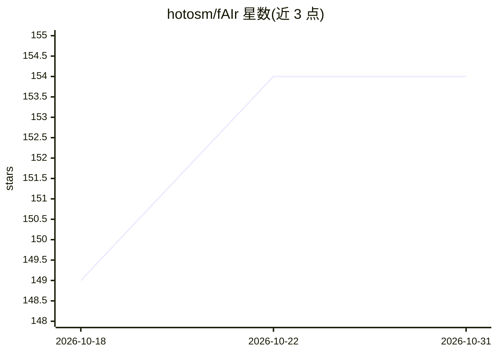

# hotosm/fAIr

⭐ 154 · TypeScript · AGPL-3.0 · 推送 2026-10-28 · [GitHub](https://github.com/hotosm/fAIr) · [官网](https://hotosm.github.io/fAIr/) · 组织维护

**人道主义制图者用的 AI 辅助地图服务：从影像检测建筑/道路等**

HOT（人道主义 OpenStreetMap 团队）开发的开源 AI 辅助制图服务，面向制图项目经理与模型开发者。使用计算机视觉模型（含 YOLOv8）从卫星与无人机影像中检测建筑、道路、水道和树木，输出可加入 OSM 的要素。支持基于本地化数据训练区域模型、经 MapSwipe 社区验证预测、通过制图者反馈迭代模型。技术栈为 Django/React/PostgreSQL/TensorFlow/PyTorch，本地开发安装通过 Docker 文档指引。影像瓦片用于训练时存储、推理时仅临时缓存。

## 筛选速览

| 维度 | 判定 | 备注 |
|---|---|---|
| AI 角色 | `ai-native` | 本体是模型或模型工具 |
| 许可风险 | `viral` | AGPL-3.0 |
| 部署形态 | `None` |  |
| 模型依赖 | — | README 未给出锁定关系 |
| 硬件要求 | — | 无带数字的原话,不猜 |
| 安装摩擦 | `low` | 无编译、无系统依赖或容器化 |
| 成熟度 | — | 结构信号不足 |

## 能力要点

- 计算机视觉模型从卫星/UAV 影像检测建筑、道路、水道、树木
- 基于本地化数据集创建区域模型，反馈闭环持续改进
- MapSwipe 社区验证 AI 预测（47 个项目、85 万+ 结果）
- 支持离线后台预测与复用预训练模型到新影像区域

## 适用场景

- 人道主义项目中对指定区域做建筑/道路等要素的 AI 检测制图
- 用本地数据训练适配当地语境的检测模型
- 模型开发者共享开源 ML 模型给制图社区

## 场景标签

`目标检测` `微调` · 领域:感知与多模态

## 证据(README 行号)

> L16: fAIr is an open AI-assisted mapping service developed by the Humanitarian OpenStreetMap Team (HOT) that aims to imp
> L27: - Map object detection using open-source ML models, open imagery and open community-led training and validation dat

## 星数曲线

2026-10-18 149 → 2026-10-31 154（+5）

---
*卡片 v1 · prompt 1.4 · 生成 2026-10-22 · 置信度 high · 依据 README sha `5e5c4ae41e65` · [字段定义](../../DATASET.md)*
