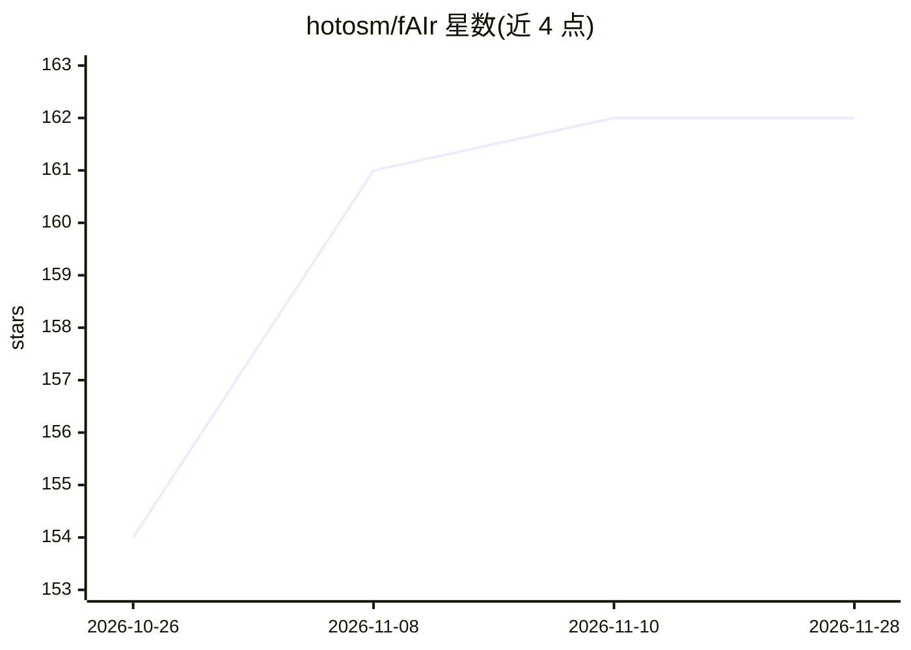

# hotosm/fAIr

⭐ 162 · TypeScript · AGPL-3.0 · 推送 2026-11-26 · [GitHub](https://github.com/hotosm/fAIr) · [官网](https://hotosm.github.io/fAIr/) · 组织维护

**人道主义制图者运行并微调地理 AI 模型的工具**

由 Humanitarian OpenStreetMap Team 开发的 AI 辅助制图工具：制图者选择共享模型库中的模型，在感兴趣区域上运行推理，验证识别结果，并用本地样本微调生成本地模型。输出以开放数据层发布到 Humanitarian Data Exchange 与 Hugging Face；明确声明将 AI 生成要素直接导入 OpenStreetMap 不在目标范围内。本地运行需 Docker Compose、Git 与至少 8 GB 内存，栈内含 Django REST 后端、React 前端及 STAC/MinIO/MLflow/ZenML 等服务。

## 筛选速览

| 维度 | 判定 | 备注 |
|---|---|---|
| AI 角色 | `ai-native` | 本体是模型或模型工具 |
| 许可风险 | `viral` | AGPL-3.0 |
| 部署形态 | `self-host` | docker 或自建部署 |
| 模型依赖 | — | README 未给出锁定关系 |
| 硬件要求 | — | 无带数字的原话,不猜 |
| 安装摩擦 | `low` | 无编译、无系统依赖或容器化 |
| 成熟度 | — | 结构信号不足 |

## 能力要点

- 模型选择→区域推理→人工验证→本地微调的工作流
- 输出以开放数据层发布到 HDX 与 Hugging Face
- 后端通过 ZenML 管线编排训练与预测，artifacts 存于 MinIO/S3
- 提供 docker compose 一键启动完整本地栈与 Swagger API 文档

## 适用场景

- 人道主义制图前用模型预识别建筑等要素再人工校验
- 用本地标注样本微调出适配本区域的模型
- 自托管完整训练/推理栈并通过 REST API 集成

## 场景标签

`微调` `目标检测` · 领域:感知与多模态

## 证据(README 行号)

> L10: fAIr connects mappers with geo-AI models they can run and adapt in their own area. It is a shared collection of mod
> L12: fAIr offers its outputs as open data layers on the Humanitarian Data Exchange and Hugging Face. Bringing AI-generat

## 星数曲线

2026-10-26 154 → 2026-11-28 162（+8）

---
*卡片 v1 · prompt 1.4 · 生成 2026-11-27 · 置信度 high · 依据 README sha `1318ad5e4ea7` · [字段定义](../../DATASET.md)*
