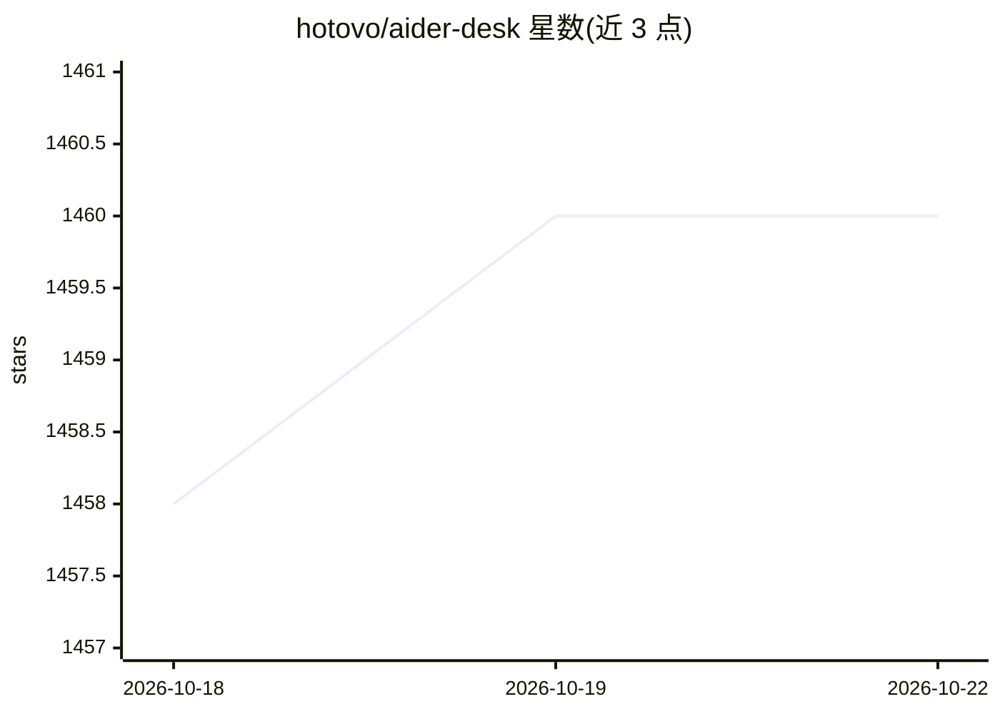

# hotovo/aider-desk

⭐ 1,460 · TypeScript · Apache-2.0 · 推送 2026-10-22 · [GitHub](https://github.com/hotovo/aider-desk) · [官网](https://aiderdesk.hotovo.com) · 组织维护

**面向专业软件工程师的 AI 编排桌面平台**

基于 Electron 的开源代理平台，最初是 Aider CLI 的图形界面，现发展为编排层：以 Project/Task 组织多代码库，用 Git Worktrees 隔离实验，提供 diff 审查、工具审批门、任务分叉与聊天记录编辑。上下文引擎用 LanceDB 向量嵌入做语义检索，支持切换 OpenAI/Anthropic/DeepSeek/Ollama 等 25+ 提供商，另有子代理、扩展系统、MCP 接入、REST API 与语音控制。Apache 2.0 许可。

## 筛选速览

| 维度 | 判定 | 备注 |
|---|---|---|
| AI 角色 | `ai-ecosystem` | LLM/agent 周边工具 |
| 许可风险 | `permissive` | Apache-2.0 |
| 部署形态 | `library` | 以包/库形式分发 |
| 模型依赖 | local-ok | 支持本地模型 |
| 硬件要求 | — | 无带数字的原话,不猜 |
| 安装摩擦 | `low` | 无编译、无系统依赖或容器化 |
| 成熟度 | — | 结构信号不足 |

## 能力要点

- Project/Task 管理与 Git Worktrees 隔离实验
- LanceDB 向量嵌入的上下文与仓库映射引擎
- 切换 25+ 模型提供商（含 Ollama）与子代理编排
- 扩展系统（30+ 生命周期钩子、自定义工具、React 组件注入）与 MCP 支持

## 适用场景

- 在带审批门的环境中让 AI 修改代码并逐行审查 diff
- 并行管理多个仓库和隔离的 AI 实验任务
- 通过 MCP 让 AI 访问 Jira/Linear 等企业系统

## 场景标签

`编码 Agent` `代码审查` · 领域:编码与开发

## 证据(README 行号)

> L14:  🤖 Not just a GUI for Aider — a complete orchestration layer.
> L24: Originally created as a graphical user interface for the powerful Aider CLI, it has evolved into a comprehensive or
> L46: - 🤖 **Subagents & Multi-Model Orchestration:** Delegate complex, multi-step problems to specialized subagents. Defi

## 星数曲线

2026-10-18 1,458 → 2026-10-22 1,460（+2）

---
*卡片 v1 · prompt 1.4 · 生成 2026-10-21 · 置信度 mid · 依据 README sha `da5d23d65321` · [字段定义](../../DATASET.md)*
