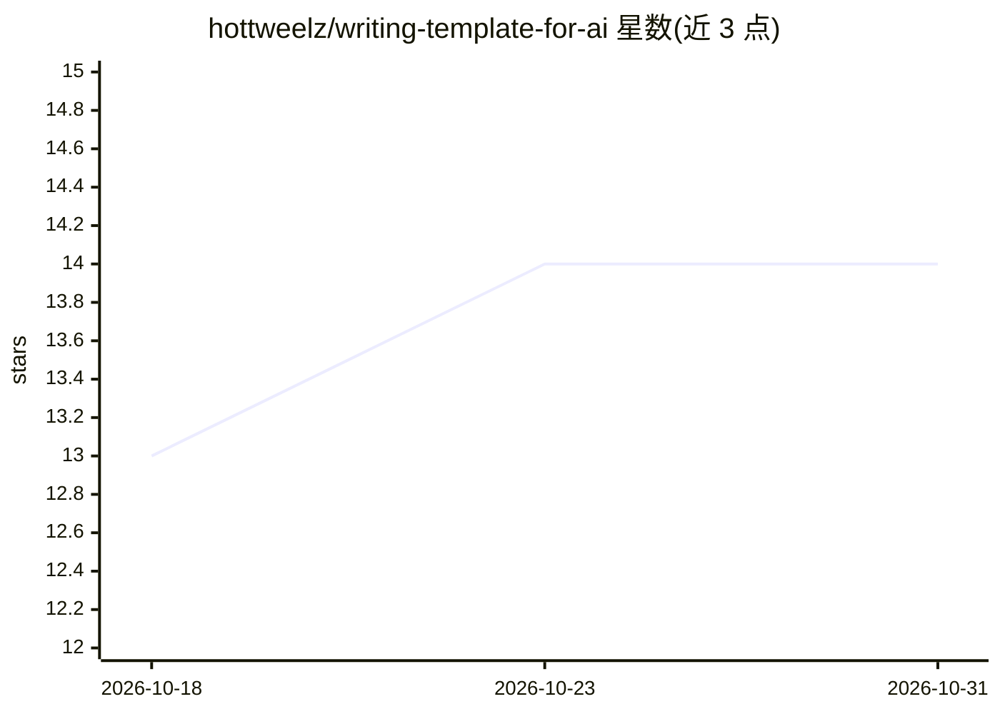

# hottweelz/writing-template-for-ai

⭐ 14 · Shell · MIT · 推送 2026-06-29 · [GitHub](https://github.com/hottweelz/writing-template-for-ai) · 个人维护

**用 AI 编码工具写书的全流程模板，产出 EPUB/PDF 书稿**

面向写书作者（尤其是小说与回忆录）的仓库模板：包含 AGENTS.md 通用契约、九个专家视角 agent、编辑规则、散文质量协议、稿件脚手架与构建脚本。用户填写 START_HERE.md 简报后，由 Claude Code、Codex、Gemini CLI 或 GitHub Copilot 生成分章蓝图并逐章起草，每章经编辑审校并写交接记录，可在四种工具间中途切换；scripts/build.sh 配合 pandoc 导出 EPUB/PDF。不处理 ISBN、封面与发行合规；Copilot 仅为尽力支持。

## 筛选速览

| 维度 | 判定 | 备注 |
|---|---|---|
| AI 角色 | `ai-native` | 本体是模型或模型工具 |
| 许可风险 | `permissive` | MIT |
| 部署形态 | `None` |  |
| 模型依赖 | locked-api |  |
| 硬件要求 | — | 无带数字的原话,不猜 |
| 安装摩擦 | `low` | 无编译、无系统依赖或容器化 |
| 成熟度 | — | 结构信号不足 |

## 能力要点

- 两阶段流程：AI 生成分章蓝图后逐章起草
- 九个专家 agent 视角（场景规划、修订、结构评审、编辑团队）
- handoff ledger 使四种 AI 工具可中途交接
- build.sh 依据 manifest 组装书稿并经 pandoc 导出 EPUB/PDF

## 适用场景

- 用 AI 编码工具从创意写到完稿的小说/回忆录创作
- 跨多个 AI 工具接力完成长篇稿件而不丢上下文
- 完稿前跑无记忆冷读评审获取出版级批评

## 场景标签

`AI 写作` · 领域:内容生成

## 证据(README 行号)

> L3: A battle-tested system for writing a book from first idea to finished manuscript using AI tools. Works with Claude C
> L9: A complete book-writing infrastructure: an AI agent team, editorial rules, prose-quality protocols, a manuscript sca
> L56: **Step 5 — The AI drafts the book, chapter by chapter.**

## 星数曲线

2026-10-18 13 → 2026-10-31 14（+1）

---
*卡片 v1 · prompt 1.4 · 生成 2026-10-31 · 置信度 high · 依据 README sha `564d170598b3` · [字段定义](../../DATASET.md)*
