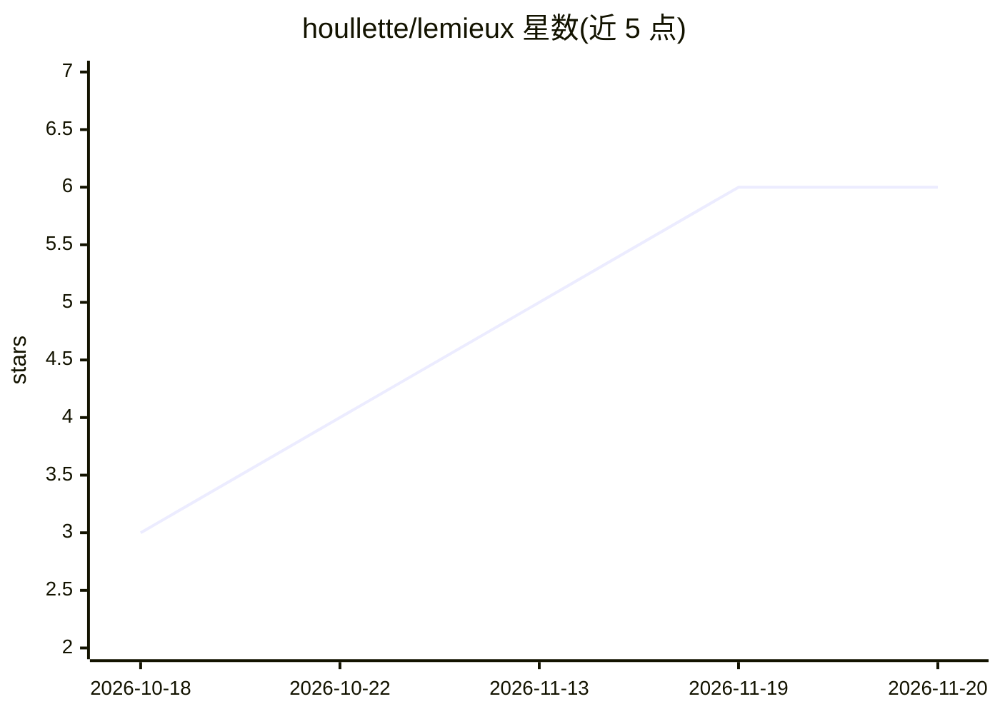

# houllette/lemieux

⭐ — · [GitHub]() · 个人维护

**开源编码 agent：终端应用 lmx 与可拆解的 Elixir 运行时**

lmx 是终端编码 agent，读取代码、编辑文件、运行命令并用项目自身测试校验结果；Lemieux 是其下层的 Elixir 库，运行 agent 循环，可嵌入应用。每次会话为磁盘上可 resume/fork/replay 的 transcript，工具、压缩与停止规则为可替换的 Elixir behaviours。经 ReqLLM 接入 Anthropic、OpenAI、Gemini 等 provider，或使用本地 Ollama 模型。提供 macOS/Linux 安装脚本、Windows 实验版、源码构建与 Hex 库依赖三种途径。

## 筛选速览

| 维度 | 判定 | 备注 |
|---|---|---|
| AI 角色 | `ai-native` | 本体是模型或模型工具 |
| 许可风险 | `permissive` | — |
| 部署形态 | `None` |  |
| 模型依赖 | local-ok | 支持本地模型 |
| 硬件要求 | — | 无带数字的原话,不猜 |
| 安装摩擦 | `low` | 无编译、无系统依赖或容器化 |
| 成熟度 | — | 结构信号不足 |

## 能力要点

- 会话以 append-only transcript 保存，可 resume、fork、replay 并打印每次模型调用的确切请求
- 工具、压缩、停止规则等是带默认实现的 Elixir behaviours，可用单文件扩展替换
- 编辑后自动运行项目检查（make/mix/npm/cargo/pytest 等），失败时最多再给模型两次机会
- 兼容 Claude Code 的 CLAUDE.md、AGENTS.md、Agent Skills、hooks、MCP servers 等配置

## 适用场景

- 在终端用所选模型完成代码阅读、编辑与命令执行
- 需要保留、fork 并审查每次 agent 会话完整记录的开发流程
- 在自己的 Elixir 应用中嵌入 agent 循环并自定义工具与审批策略

## 场景标签

`编码 Agent` `Agent 框架` · 领域:Agent 开发

## 证据(README 行号)

> L8: **An open-source coding agent you can take apart: a terminal app (lmx), and the Elixir runtime underneath it (Lemieu
> L10: **`lmx`** is a coding agent for your terminal: it reads your code, edits
> L13: Ollama. **Lemieux** is the Elixir library underneath. It runs the agent loop

## 星数曲线

2026-10-18 3 → 2026-11-20 6（+3）

---
*卡片 v1 · prompt 1.4 · 生成 2026-11-20 · 置信度 high · 依据 README sha `0478c9ff12e2` · [字段定义](../../DATASET.md)*
