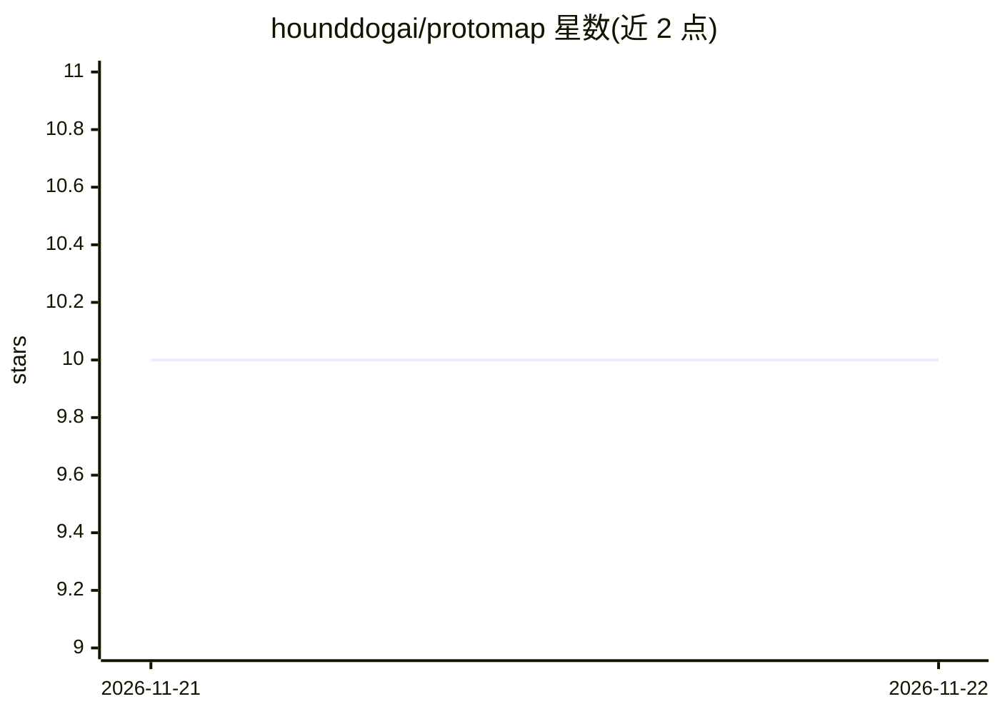

# hounddogai/protomap

⭐ 10 · Shell · 推送 2026-11-20 · [GitHub](https://github.com/hounddogai/protomap) · [官网](https://protomap.ai) · 组织维护

**gRPC/Protobuf 架构图引擎，供团队与编码代理查询调用关系**

ProtoMap 由 HoundDog.ai 开发，扫描仓库中的 .proto 文件与 Go/C#/Java/Python/Rust 等十余种语言的 gRPC 代码，构建服务间调用关系图，细化到方法、消息、字段与每个调用点。功能包括查看架构、评估变更影响范围、追踪字段流向、基于扫描数据回答问题的助手（接入用户自选的 AI provider），以及通过 MCP 将同一份图提供给编码代理。以自托管服务器加 CLI 形式分发，CLI 支持自动更新与回滚。

## 筛选速览

| 维度 | 判定 | 备注 |
|---|---|---|
| AI 角色 | `ai-enhanced` | 去掉 AI 部分产品仍成立 |
| 许可风险 | `none` | — |
| 部署形态 | `None` |  |
| 模型依赖 | — | README 未给出锁定关系 |
| 硬件要求 | — | 无带数字的原话,不猜 |
| 安装摩擦 | `low` | 无编译、无系统依赖或容器化 |
| 成熟度 | — | 结构信号不足 |

## 能力要点

- 扫描 .proto 与 gRPC 代码，生成到字段级与调用点级的服务依赖图
- 通过 MCP 服务器（protomap mcp serve）将架构图提供给编码代理
- 内置助手基于扫描结果回答并绘制图示，使用用户自连的 AI provider
- CLI 静态构建支持 macOS/Linux/Windows，含版本固定、自动更新与回滚机制

## 适用场景

- 修改某个 RPC 前查看会波及哪些服务、消费者与调用点
- 追踪一个 protobuf 字段跨服务的逐步流向
- 让 Claude Code 等编码代理在读代码时叠加仓库的最新架构图
- 在 CI 中用组织级 API key 自动扫描保持共享图更新

## 场景标签

 · 领域:开发者工具/代码分析

## 证据(README 行号)

> L3: ProtoMap by HoundDog.ai maps your gRPC services: which services call which, through which methods and protobuf field
> L17: - **Ask the assistant.** It answers from your scans, with file locations, and draws diagrams, using the AI provider
> L19: - **Give coding agents the graph.** Over MCP, with your uncommitted changes laid over the shared graph.

## 星数曲线

2026-11-21 10 → 2026-11-22 10（+0）

---
*卡片 v1 · prompt 1.4 · 生成 2026-11-21 · 置信度 high · 依据 README sha `3686cf60d766` · [字段定义](../../DATASET.md)*
