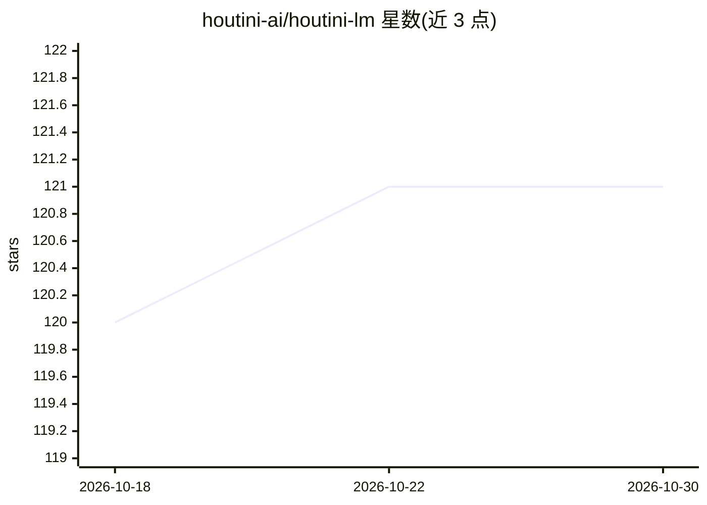

# houtini-ai/houtini-lm

⭐ 121 · TypeScript · Apache-2.0 · 推送 2026-10-25 · [GitHub](https://github.com/houtini-ai/houtini-lm) · [官网](https://houtini.com/how-to-cut-your-claude-code-bill-with-houtini-lm/) · 个人维护

**把有界任务从 Claude Code 委派给本地/云端 LLM 的 MCP server**

面向 Claude Code 等 MCP 客户端的 MCP server：将代码审查、测试桩、commit 信息、格式转换等有界任务转交给另一模型执行——本地 LLM（LM Studio/Ollama/vLLM）、OpenAI、LiteLLM 路由、OpenRouter 或 DeepSeek/Groq 等，源文件由本进程读取后直发目标模型，不进入 Claude 上下文，README 实测四类审查任务平均节省 93.3% token。提供按模型族（Qwen/LLaMA/GPT 等）的参数适配、思考开关、模型评分选择与并发队列控制。需 Node 22.5+ 与 OpenAI 兼容端点。

## 筛选速览

| 维度 | 判定 | 备注 |
|---|---|---|
| AI 角色 | `ai-ecosystem` | LLM/agent 周边工具 |
| 许可风险 | `permissive` | Apache-2.0 |
| 部署形态 | `self-host` | docker 或自建部署 |
| 模型依赖 | local-ok | 支持本地模型 |
| 硬件要求 | — | 无带数字的原话,不猜 |
| 安装摩擦 | `low` | 无编译、无系统依赖或容器化 |
| 成熟度 | — | 结构信号不足 |

## 能力要点

- 8 个 MCP 工具，源文件由进程直读直发，不进入 Claude 上下文（README 基准平均省 93.3% token）
- 支持 LM Studio/Ollama/vLLM/LiteLLM/OpenRouter/OpenAI/DeepSeek/Groq 等多种端点
- 按模型族维护适配档案（温度/输出上限/思考块处理），缓存于 SQLite
- 多模型时按任务类型评分并建议最优模型

## 适用场景

- 把代码审查、commit 信息等有界任务交给更便宜的模型以降低 token 账单
- 用另一个模型给代码或方案提供第二意见
- 让代码留在本地 GPU 模型上以保护隐私

## 场景标签

`代码审查` · 领域:编码与开发

## 证据(README 行号)

> L10: **Houtini LM is an MCP server that lets Claude (or any MCP client) hand bounded work to another model - a local LLM
> L66: You'll need Node 22.5 or newer and an OpenAI-compatible endpoint: LM Studio, Ollama, vLLM, SGLang, a LiteLLM router

## 星数曲线

2026-10-18 120 → 2026-10-30 121（+1）

---
*卡片 v1 · prompt 1.4 · 生成 2026-10-23 · 置信度 high · 依据 README sha `07780cc06216` · [字段定义](../../DATASET.md)*
