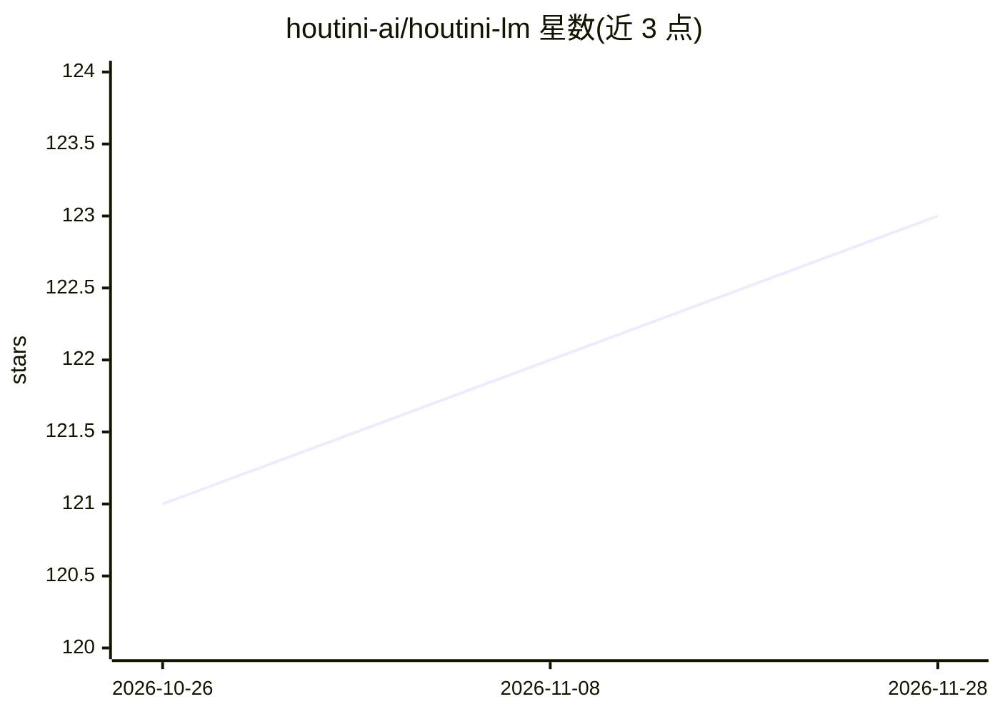

# houtini-ai/houtini-lm

⭐ 123 · TypeScript · Apache-2.0 · 推送 2026-11-07 · [GitHub](https://github.com/houtini-ai/houtini-lm) · [官网](https://houtini.com/how-to-cut-your-claude-code-bill-with-houtini-lm/) · 个人维护

**MCP 服务器：把 Claude Code 的有界任务分流给本地或云端 LLM**

一个 MCP 服务器，让 Claude 或其他 MCP 客户端将有界工作（代码审查、测试桩、提交信息、格式转换、嵌入生成等）交给另一个模型执行：本地 GPU 上的开源模型、OpenAI GPT 系列、LiteLLM 路由、OpenRouter 或云端 API。文件由 houtini-lm 进程直接读取发给目标模型，不进入 Claude 上下文窗口，README 实测四个审查任务平均节省 93.3% token。启动时枚举服务器模型并查 HuggingFace 缓存到 SQLite，按模型家族套用温度、输出上限与思考块处理策略，多模型时按任务类型打分选择。需要 Node 22.5+ 与 OpenAI 兼容端点。

## 筛选速览

| 维度 | 判定 | 备注 |
|---|---|---|
| AI 角色 | `ai-ecosystem` | LLM/agent 周边工具 |
| 许可风险 | `permissive` | Apache-2.0 |
| 部署形态 | `self-host` | docker 或自建部署 |
| 模型依赖 | local-ok | 支持本地模型 |
| 硬件要求 | — | 无带数字的原话,不猜 |
| 安装摩擦 | `low` | 无编译、无系统依赖或容器化 |
| 成熟度 | — | 结构信号不足 |

## 能力要点

- 文件不经 Claude 上下文窗口直接发给目标模型，四任务平均省 93.3% token
- 启动时查询 HuggingFace 获取架构与模板并缓存到 SQLite，按 Qwen/LLaMA/GLM 等家族配置策略
- 支持 LiteLLM 路由别名解析、OpenAI 参数适配（max_completion_tokens）、思考模式 auto/off/on
- 提供 discover/list_models 等 8 个 MCP 工具

## 适用场景

- 让 Claude Code 把代码审查、测试桩等有界任务交给便宜或本地模型
- 为大型重构准备第二个模型做独立代码评审
- 在 16-128GB VRAM 的机器上挑选并运行合适的本地模型

## 场景标签

`模型网关` `代码生成` `代码审查` · 领域:Agent 开发

## 证据(README 行号)

> L11: **Houtini LM is an MCP server that lets Claude (or any MCP client) hand bounded work to another model - a local LLM
> L67: You'll need Node 22.5 or newer and an OpenAI-compatible endpoint: LM Studio, Ollama, vLLM, SGLang, a LiteLLM router

## 星数曲线

2026-10-26 121 → 2026-11-28 123（+2）

---
*卡片 v1 · prompt 1.4 · 生成 2026-11-28 · 置信度 high · 依据 README sha `e74e3180659d` · [字段定义](../../DATASET.md)*
