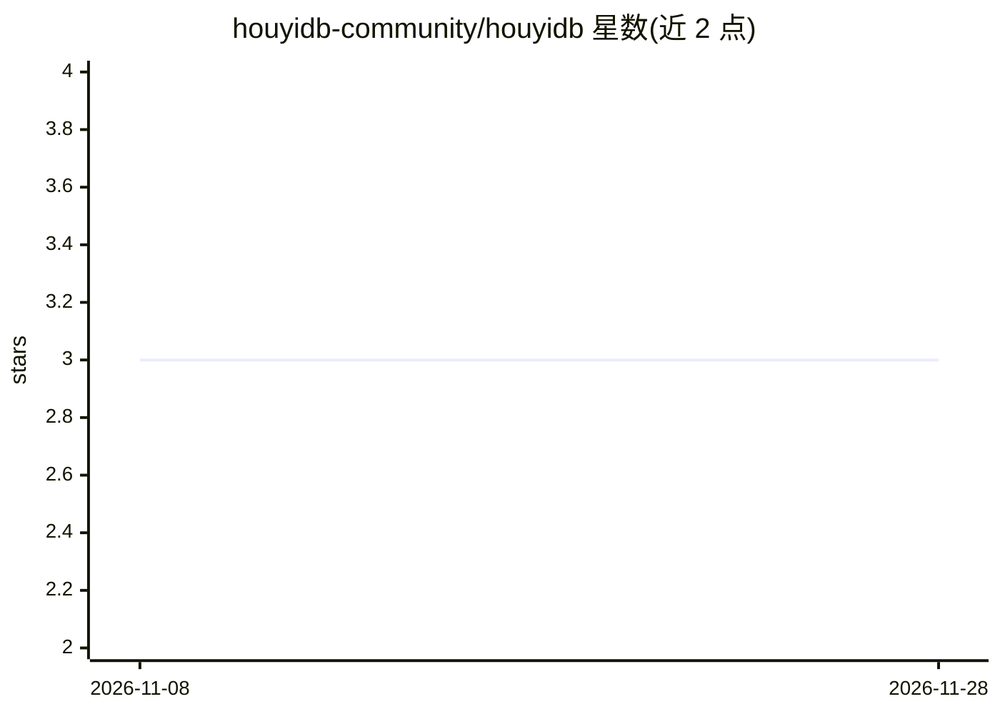

# houyidb-community/houyidb

⭐ 3 · Rust · Apache-2.0 · 推送 2026-11-23 · [GitHub](https://github.com/houyidb-community/houyidb) · [官网](https://houyidb.top) · 个人维护 · 中文 README

**面向 RAG/嵌入检索场景的单机向量数据库**

Rust 编写的单机内存优先向量数据库，核心机制为 HNSW 向量索引、PAX 行列混存、pg_wire 与 HTTP 双接口、WAL 持久化与快照恢复。面向需要向量检索与混合检索的开发者，供 RAG 等场景使用。提供 Docker 与源码两种启动方式、OpenAPI 交互文档、Recall 门禁与 VectorDBBench 复现协议；附带六语言 SDK、LangChain/LlamaIndex adapter 与 MCP server。README 标注版本 v0.2.0-beta.8，公开报告只含自测数据。

## 筛选速览

| 维度 | 判定 | 备注 |
|---|---|---|
| AI 角色 | `ai-ecosystem` | LLM/agent 周边工具 |
| 许可风险 | `permissive` | Apache-2.0 |
| 部署形态 | `self-host` | docker 或自建部署 |
| 模型依赖 | — | README 未给出锁定关系 |
| 硬件要求 | — | 无带数字的原话,不猜 |
| 安装摩擦 | `low` | 无编译、无系统依赖或容器化 |
| 成熟度 | — | 结构信号不足 |

## 能力要点

- HNSW 向量检索 + PAX 行列混存 + WAL 持久化，kill -9 后重启恢复
- pg_wire/HTTP 双接口，SQL 混合检索与谓词下推 bitset 剪枝
- Python/TypeScript/Go/Rust/.NET/Java 六语言 SDK 与 LangChain/LlamaIndex adapter
- MCP server 可接入 Claude Code、Cursor、Cline 等客户端；移动端 C ABI 索引（iOS/Android）

## 适用场景

- 为 RAG 应用存储并检索嵌入向量
- 通过 SQL（pg_wire）或 HTTP API 做混合检索
- 在 iOS/Android 应用中集成轻量向量索引

## 场景标签

`向量数据库` · 领域:知识与检索

## 证据(README 行号)

> L7: 单机、内存优先的向量数据库：HNSW 向量检索 + PAX 行列混存 + pg_wire/HTTP 双接口 + WAL 持久化。
> L70: - `houyi-server`: HTTP API（collection upsert 带 payload、hybrid search 带 scores）、pg_wire 连接处理、指标输出
> L84: **MCP**：`mcp/houyidb-mcp` 提供 stdio MCP server（collection 列表、检索、混合检索、可选写入），可接入 Claude Code、Cursor、Cline 等客户端。

## 星数曲线

2026-11-08 3 → 2026-11-28 3（+0）

---
*卡片 v1 · prompt 1.4 · 生成 2026-11-21 · 置信度 high · 依据 README sha `d3a8864e64a5` · [字段定义](../../DATASET.md)*
