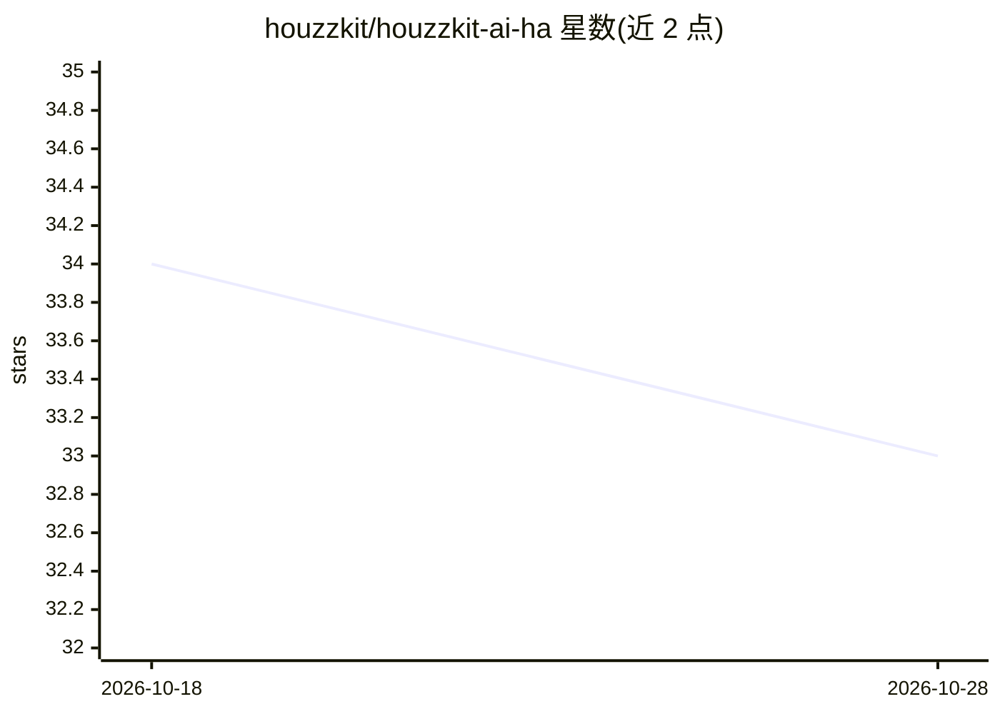

# houzzkit/houzzkit-ai-ha

⭐ 33 · Python · Apache-2.0 · 推送 2026-10-10 · [GitHub](https://github.com/houzzkit/houzzkit-ai-ha) · 组织维护 · 中文 README

**小瑞 Agent 智能音箱接入 Home Assistant 的自定义集成**

HOUZZkit AI HA 是「小瑞 Agent」智能音箱的 Home Assistant 自定义集成：音箱通过 ESPHome 深度接入并以标准设备和实体展示，AI 通过 MCP 查询与控制已公开给语音助手的实体，支持自然语言批量控制（如'打开除了客厅以外的灯'）。支持灯、开关、空调、窗帘等 8 类设备的状态查询、开关、数值调节与模式设置。最低要求 Home Assistant 2025.10.0，Release 版本号与 HA 年月大版本一一对应，可通过 HACS 或手动复制 custom_components 安装，绑定需微信小程序扫码且要求设备与 HA 在同一局域网。

## 筛选速览

| 维度 | 判定 | 备注 |
|---|---|---|
| AI 角色 | `ai-native` | 本体是模型或模型工具 |
| 许可风险 | `permissive` | Apache-2.0 |
| 部署形态 | `None` |  |
| 模型依赖 | — | README 未给出锁定关系 |
| 硬件要求 | — | 无带数字的原话,不猜 |
| 安装摩擦 | `low` | 无编译、无系统依赖或容器化 |
| 成熟度 | — | 结构信号不足 |

## 能力要点

- 通过 MCP 控制 Home Assistant 中已公开给语音助手的实体
- 自然语言批量控制与例外指令（'关闭除了客厅以外的灯'）
- 支持 8 类设备的状态查询、开关、数值调节与运行模式设置
- HACS 安装，Release 版本号与 Home Assistant 年月大版本对应

## 适用场景

- 用智能音箱语音控制家里的灯、空调、窗帘等设备
- 把智能音箱实体纳入 Home Assistant 自动化规则
- 用自然语言批量或按例外条件控制设备

## 场景标签

`语音 Agent` · 领域:对话与助手

## 证据(README 行号)

> L3: HOUZZkit AI HA 是「小瑞 Agent」的 Home Assistant 自定义集成。
> L7: - **语音控制 Home Assistant 设备**：通过 MCP 控制 Home Assistant 中已公开给语音助手的实体。
> L9: - **支持自然语言批量控制**：可用“打开所有灯”“关闭除了客厅以外的灯”等自然语言指令控制设备。

## 星数曲线

2026-10-18 34 → 2026-10-28 33（-1）

---
*卡片 v1 · prompt 1.4 · 生成 2026-10-25 · 置信度 high · 依据 README sha `dde8a983cd9b` · [字段定义](../../DATASET.md)*
