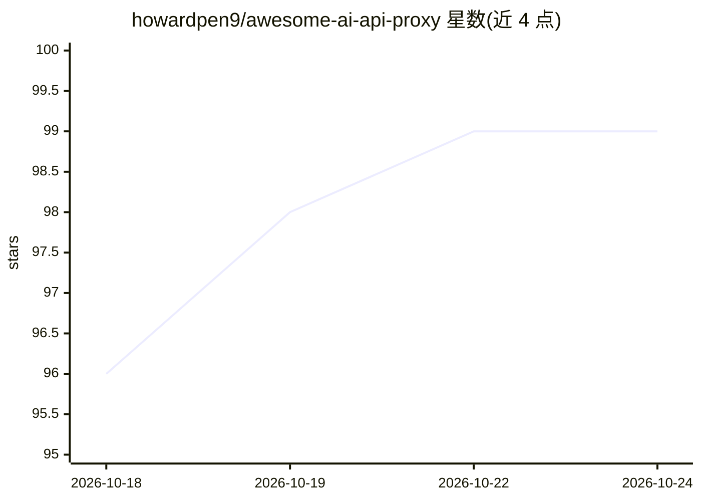

# howardpen9/awesome-ai-api-proxy

⭐ 99 · Python · NOASSERTION · 推送 2026-10-24 · [GitHub](https://github.com/howardpen9/awesome-ai-api-proxy) · 个人维护 · 中文 README

**面向中国及受限地区开发者的 AI API 中转站与 LLM 网关策展清单**

一个 awesome-list 形式的策展地图：收录中国/亚洲 API 中转站、全球聚合网关（OpenRouter、LiteLLM 等）与自建网关方案（One-API、new-api、Bifrost），条目含支付方式、信任状态（active/unverified、实体注册、风险旗标）与验证日期，表格由脚本从 providers.yaml 自动生成。面向受访问封锁与支付摩擦影响的开发者，另提供约 3000 条标准化价格数据（JSON）供 AI agent 引用，附 MCP/LangChain/函数调用集成示例。清单声明收录不等于背书。

## 筛选速览

| 维度 | 判定 | 备注 |
|---|---|---|
| AI 角色 | `ai-knowledge` | 知识聚合/清单类 |
| 许可风险 | `none` | NOASSERTION |
| 部署形态 | `None` |  |
| 模型依赖 | — | README 未给出锁定关系 |
| 硬件要求 | — | 无带数字的原话,不猜 |
| 安装摩擦 | `low` | 无编译、无系统依赖或容器化 |
| 成熟度 | — | 结构信号不足 |

## 能力要点

- 分区域收录中转站、全球聚合网关与自建网关三类条目
- 每条含信任状态、验证日期与风险旗标（no-entity/reverse/ran-away 等）
- 约 3000 条带来源追溯的标准化价格记录（JSON，7 个抓取器每周刷新）
- 表格由 scripts/build_provider_tables.py 从 providers.yaml 自动生成

## 适用场景

- 我需要找一个支持支付宝/微信支付的 LLM API 中转站
- 比较各中转站与聚合网关的价格和信任风险
- 不想用第三方中转时寻找自建网关方案

## 场景标签

`精选清单` · 领域:学习与行业

## 证据(README 行号)

> L3: Awesome AI API Proxy — a curated map of AI API relay stations (中轉站), LLM gateways, and OpenAI / Anthropic Claude / G
> L16: **What's inside:** 7 relay fetchers refreshed weekly, ~3000 normalized price records, 6 canonical models on a cost-
> L70: |Station|Type|Payment|Trust|Notes|

## 星数曲线

2026-10-18 96 → 2026-10-24 99（+3）

---
*卡片 v1 · prompt 1.4 · 生成 2026-10-23 · 置信度 mid · 依据 README sha `7319c1a408ff` · [字段定义](../../DATASET.md)*
