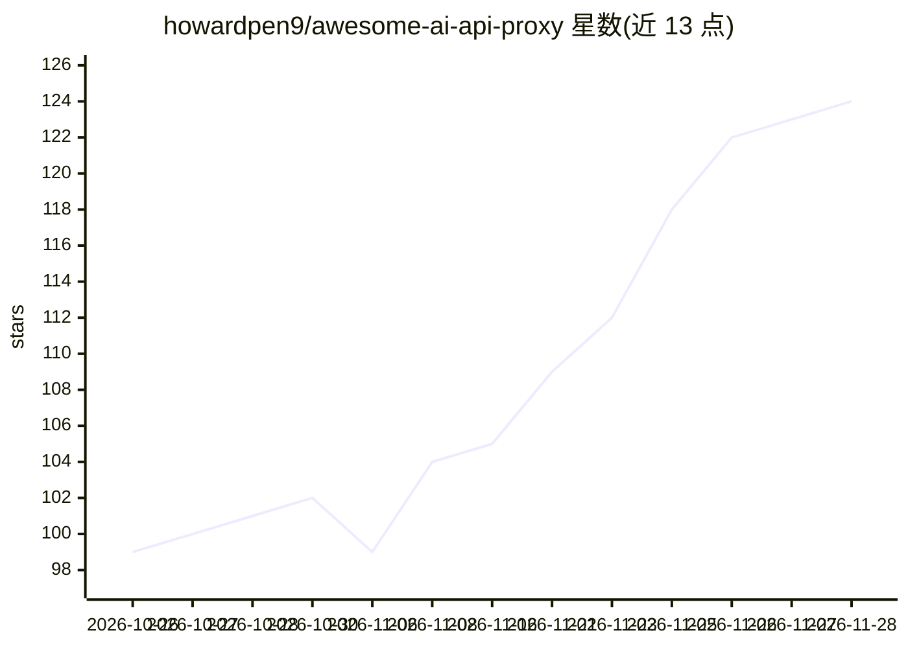

# howardpen9/awesome-ai-api-proxy

⭐ 124 · Python · NOASSERTION · 推送 2026-11-22 · [GitHub](https://github.com/howardpen9/awesome-ai-api-proxy) · 个人维护 · 中文 README

**面向开发者（含 AI agent）的 AI API 中转站与网关策展清单**

一份策展型清单与配套数据集：收录中国/亚洲 API 中转站、全球网关聚合器与自托管网关项目，提供状态标记、支付方式、信任旗标与价格信息；附带每周刷新的价格 JSON（约 3000 条记录）与 MCP/LangChain/HTTP 等接入示例，供 agent 直接消费。定位为开发者与 applications 服务，并区分中转站与镜像站（面向终端用户的聊天网页）。维护者声明收录不代表背售。

## 筛选速览

| 维度 | 判定 | 备注 |
|---|---|---|
| AI 角色 | `ai-knowledge` | 知识聚合/清单类 |
| 许可风险 | `none` | NOASSERTION |
| 部署形态 | `None` |  |
| 模型依赖 | — | README 未给出锁定关系 |
| 硬件要求 | — | 无带数字的原话,不猜 |
| 安装摩擦 | `low` | 无编译、无系统依赖或容器化 |
| 成熟度 | — | 结构信号不足 |

## 能力要点

- 收录 13+ 亚洲中转站、20+ 全球网关、4 个自托管网关项目条目
- 提供 prices.latest.json 机器可读价格数据，含 source_url 与 captured_at 溯源字段
- 信任标记体系：active/unverified/inactive 状态与 operator-self、reverse、ran-away 等旗标
- 提供 MCP / LangChain / OpenAI function-calling / HTTP 接入示例文档

## 适用场景

- 为 AI agent 选一个统一价格与接入入口的中转 API
- 在支付受限地区寻找支持支付宝/微信的模型 API 渠道
- 对比各家网关与聚合器的价格、支付方式与信任状态
- 自托管场景下挑选 One-API/new-api/LiteLLM 类网关

## 场景标签

`精选清单` · 领域:学习与行业

## 证据(README 行号)

> L3: Awesome AI API Proxy — a curated map of AI API relay stations (中轉站), LLM gateways, and OpenAI / Anthropic Claude / G
> L16: **What's inside:** 7 relay fetchers refreshed weekly, ~3000 normalized price records, 6 canonical models on a cost-

## 星数曲线

2026-10-26 99 → 2026-11-28 124（+25）

---
*卡片 v1 · prompt 1.4 · 生成 2026-11-28 · 置信度 mid · 依据 README sha `21cef5cb6bec` · [字段定义](../../DATASET.md)*
