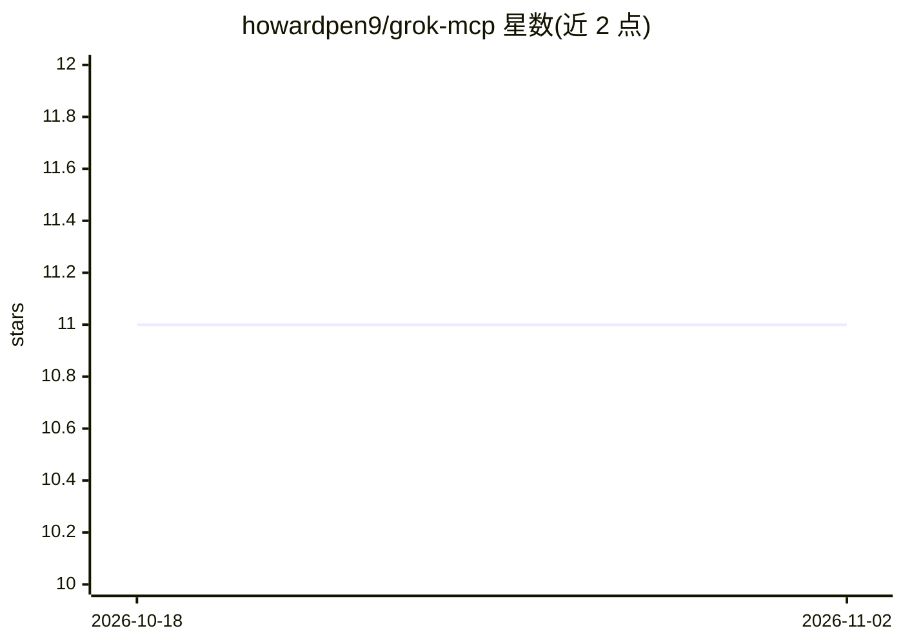

# howardpen9/grok-mcp

⭐ 11 · TypeScript · MIT · 推送 2026-07-28 · [GitHub](https://github.com/howardpen9/grok-mcp) · [官网](https://www.npmjs.com/package/grok-cli-mcp) · 个人维护 · 中文 README

**让 Claude Code/Cursor 等 MCP 宿主调用 Grok 做代码评审的 MCP 服务器**

MCP 服务器（npm 包 grok-cli-mcp），把 xAI Grok 接入 Claude Code、Cursor、Cline 等 MCP 宿主，供主 agent 委托 Grok 做第二意见与验证。提供四个无状态工具：grok_chat（一次性问答）、grok_review（diff 分维度评分评审）、grok_consult（多轮咨询）、grok_challenge（缺陷/竞态/安全分析）。后端二选一：XAI_API_KEY 直连 xAI API，或浏览器 OAuth 走 Grok CLI。另附 Streamable HTTP 远程模式与 GitHub Action PR 门禁。默认模型 grok-4，默认单次超时 300 秒。

## 筛选速览

| 维度 | 判定 | 备注 |
|---|---|---|
| AI 角色 | `ai-ecosystem` | LLM/agent 周边工具 |
| 许可风险 | `permissive` | MIT |
| 部署形态 | `library` | 以包/库形式分发 |
| 模型依赖 | locked-api |  |
| 硬件要求 | — | 无带数字的原话,不猜 |
| 安装摩擦 | `low` | 无编译、无系统依赖或容器化 |
| 成熟度 | — | 结构信号不足 |

## 能力要点

- 四个工具：chat / review / consult / challenge，均无状态、仅输出 stdout
- 双后端：XAI_API_KEY 直连 API 或 Grok CLI 浏览器 OAuth
- grok_review 输出 verdict 与五维评分，支持 JSON 格式用于 CI 门禁
- 附带 Streamable HTTP 远程模式（v0.4+，路径密钥保护）与 GitHub Action

## 适用场景

- 在 Claude Code / Cursor 编码会话内让 Grok 做第二意见评审
- 用 grok_challenge 检查缺陷、竞态与安全问题
- 在 CI 中对每个 PR 自动评审并按 verdict 阻断合并

## 场景标签

`代码审查` · 领域:编码与开发

## 证据(README 行号)

> L10: `grok-mcp` (npm: `grok-cli-mcp`) is a Model Context Protocol server for Grok. It gives your primary agent (Claude, 
> L21: Most "Grok MCP" packages expose Grok's chat/search/image capabilities so Claude can *use* Grok. `grok-mcp` lets you

## 星数曲线

2026-10-18 11 → 2026-11-02 11（+0）

---
*卡片 v1 · prompt 1.4 · 生成 2026-11-02 · 置信度 high · 依据 README sha `86a86044e270` · [字段定义](../../DATASET.md)*
