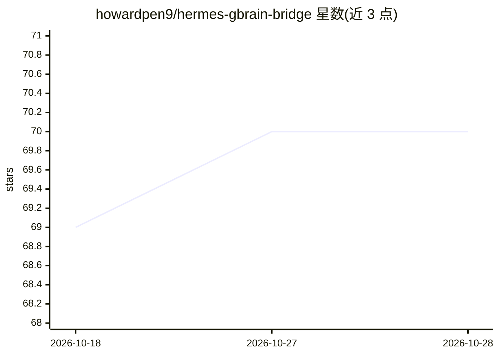

# howardpen9/hermes-gbrain-bridge

⭐ 70 · TypeScript · MIT · 推送 2026-04-13 · [GitHub](https://github.com/howardpen9/hermes-gbrain-bridge) · 个人维护 · 中文 README

**把各类 AI agent 记忆转换为 markdown 供 gBrain 导入的桥接工具**

零依赖的 Bun/TypeScript 桥接器：读取 Hermes、Claude Code、Codex CLI、OpenClaw 等工具散落在本机的 JSONL 会话与 markdown 记忆，过滤事件流噪声、按 mtime 窗口与最小尺寸筛选、执行密钥脱敏（sk-*、ghp_* 等模式），转换为每个会话一个 markdown 文件供 gBrain（仅接受 markdown 的知识库）导入。它不直接写数据库，仅产出文件；新增数据源需编写约 100 行适配器。自述为单人日常使用的 MVP，OpenClaw SQLite、Gemini/Kimi CLI 等来源尚未支持。

## 筛选速览

| 维度 | 判定 | 备注 |
|---|---|---|
| AI 角色 | `ai-ecosystem` | LLM/agent 周边工具 |
| 许可风险 | `permissive` | MIT |
| 部署形态 | `None` |  |
| 模型依赖 | — | README 未给出锁定关系 |
| 硬件要求 | — | 无带数字的原话,不猜 |
| 安装摩擦 | `low` | 无编译、无系统依赖或容器化 |
| 成熟度 | `idea` | |

## 能力要点

- 支持 4 种来源（Hermes/Claude Code/Codex/OpenClaw 归档），另有 4 种标注待实现
- 默认开启 mtime 窗口、最小尺寸过滤与密钥脱敏
- 零运行时依赖（纯 Bun/TS + Node 标准库），适配器统一走 CanonicalEvent 中间格式
- 不直接写数据库，仅产出 markdown，由 gBrain 负责导入与嵌入

## 适用场景

- 把多年的 Claude Code/Codex 会话记录导入 gBrain 形成可检索知识库
- 在多个 agent 工具的分散记忆间做统一归档与脱敏导出
- 为自建 agent 技术栈编写新的记忆源适配器

## 场景标签

`Agent 记忆` · 领域:Agent 开发

## 证据(README 行号)

> L3: > A small, dependency-free bridge that converts scattered agent memory (Hermes, Claude Code, Codex, OpenClaw) into c
> L7: Most agent tools write memory in their own format — JSONL event streams, flat-key text, SQLite. gBrain only imports 
> L32: The bridge never touches the database directly. It only produces markdown files. gBrain handles ingestion, chunking

## 星数曲线

2026-10-18 69 → 2026-10-28 70（+1）

---
*卡片 v1 · prompt 1.4 · 生成 2026-10-24 · 置信度 high · 依据 README sha `adc6beabe875` · [字段定义](../../DATASET.md)*
